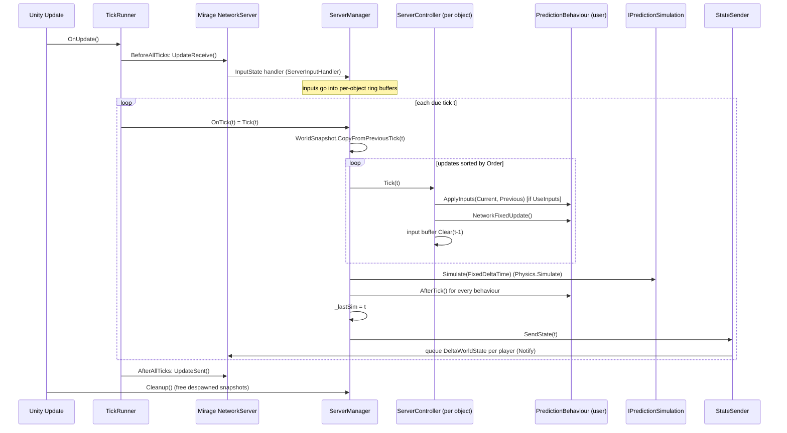
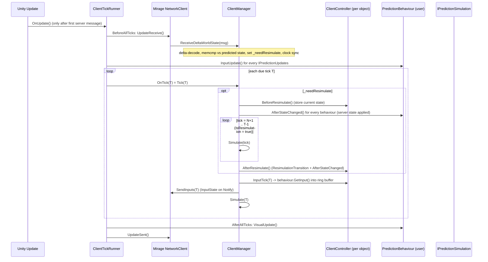
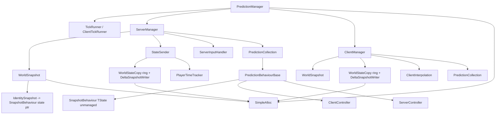

# 01 - Architecture and Lifecycle

**Summary.** One `PredictionManager` MonoBehaviour is the only Unity entry point (`Start`, `Update`, `OnDestroy`). It builds either a `ServerManager` (server) or a `ClientManager` (client) when Mirage's server/client start, and drives them from a `TickRunner` whose events also pump Mirage's receive/send. Every spawned `PredictionBehaviour` gets a per-object `ClientController`/`ServerController`, but the managers own the *world-level* things: the snapshot memory, state send/receive, and the resimulation loop.
For the timing algorithm itself see `TickRunner-and-TimeSync.md` (separate file); only a summary is given here.

All paths below are relative to the CSP repo root. `R/` is shorthand used **only in prose** for `Assets/source/Runtime/`; citations always use the full path.

## 1. Cast of classes

| Class | File | Instances | Role |
|---|---|---|---|
| `PredictionManager` | `Assets/source/Runtime/PredictionManager.cs:30` | 1 per scene/NetworkManager (MonoBehaviour) | Creates managers + tick runner when Mirage server/client start; owns the shared `SimpleAlloc`; drives `TickRunner.OnUpdate()` from Unity `Update`; exposes `SetClientReady`/`SetServerRunning`. |
| `TickRunner` / `ClientTickRunner` / `PredictionTime` | `Assets/source/Runtime/TickRunner.cs:36,235,17` | 1 per side | Fixed-rate tick loop + (client) clock sync. `PredictionTime` is the `IPredictionTime` handed to user code. Covered in the other file. |
| `ServerManager` | `Assets/source/Runtime/ServerManager.cs:23` | 1 on server | Per-tick server simulation; owns `WorldSnapshot`, `StateSender`, `ServerInputHandler`, player trackers. |
| `ClientManager` | `Assets/source/Runtime/ClientManager.cs:26` | 1 on a non-host client | Per-tick client prediction; owns `WorldSnapshot`, received-state ring, delta reader, `ClientInterpolation`; does resimulation and input sending. |
| `PredictionCollection` | `Assets/source/Runtime/PredictionCollection.cs:42` | 1 per manager | Sorted lists of `IPredictionUpdates` and `IPredictionBehaviour` with deferred add/remove. |
| `ClientController<TInput,TState>` / `ServerController<TInput,TState>` | `Assets/source/Runtime/ClientController.cs:22`, `Assets/source/Runtime/ServerController.cs:22` | 1 per PredictionBehaviour per side | Per-object input buffer and per-object steps of the tick (input gather/apply, before/after-resim state capture). |
| `PredictionBehaviourBase<TInput,TState>` | `Assets/source/Runtime/PredictionBehaviour.cs:38` | user subclasses | User API (see file 02); derives from `SnapshotBehaviour<TState>` which derives from Mirage `NetworkBehaviour`. |
| `WorldSnapshot` / `IdentitySnapshot` | `Assets/source/Runtime/DeltaSnapshot/WorldSnapshot.cs:22,119` | 1 per manager / 1 per identity with a snapshot behaviour | Unmanaged ring buffer of per-tick state. Covered in file 04. |
| `StateSender` | `Assets/source/Runtime/StateSender.cs:24` | 1 on server | Builds and sends `DeltaWorldState` per player per tick. |
| `ServerInputHandler` | `Assets/source/Runtime/ServerInputHandler.cs:19` | 1 on server | Decodes `InputState`, validates, routes to controllers. |
| `ClientInterpolation` | `Assets/source/Runtime/ClientInterpolation.cs:459` | 1 on client (added as an `IPredictionUpdates`) | Remote-object interpolation helper (file 06). |
| `SimpleAlloc` (`IAllocator`) | `Assets/source/Runtime/Alloc/SimpleAlloc.cs:102` | 1, shared by server and client managers | Marshal.AllocHGlobal bookkeeping. |

## 2. How CSP is wired into Mirage

### 2.1 Who creates what

`PredictionManager` has inspector references to a Mirage `NetworkServer` and/or `NetworkClient` (`Assets/source/Runtime/PredictionManager.cs:37-38`). It does not use any Mirage module/plugin hook; it just subscribes to events:

```
Start()                                  PredictionManager.cs:82-102
  _simpleAlloc = new SimpleAlloc()                    (84)
  _simulation  = new DefaultPredictionSimulation(...) (86-87, unless SetPredictionSimulation was called first)
  Server.Started/Stopped  -> ServerStarted/ServerStopped   (91-92)
  Client.Started/Disconnected -> ClientStarted/ClientStopped (98-99)
  Server.ManualUpdate = false ; Client.ManualUpdate = false   (93, 100)

ServerStarted()                          PredictionManager.cs:113-136
  new TickRunner{TickRate}, new PredictionTime(runner)
  new ServerManager(simulation, runner, time, Server.World, alloc, Server.MessageHandler)
  serverManager.Behaviours.Add(UniTaskExtras.CustomTimingHelper.Init())
  Server.Authenticated -> serverManager.AddPlayer ; Server.Disconnected -> RemovePlayer
  runner.BeforeAllTicks += Server.UpdateReceive ; runner.AfterAllTicks += Server.UpdateSent
  SetServerRunning(AutoStart || _serverRunning)

ClientStarted()                          PredictionManager.cs:158-197
  host:  serverManager.SetHostMode(); register no-op DeltaWorldState handler; AddClientEvents(serverManager.Behaviours)
  else:  Client.World.Time.PingInterval = PingInterval
         new ClientTickRunner(...) ; new PredictionTime ; new ClientManager(..., Client.World, Client.Player, Client.MessageHandler, alloc)
         AddClientEvents(clientManager.Behaviours) ; add UniTask timing helper
         SetClientReady(AutoStart || _clientReady)
```

### 2.2 Mirage touch points

| Mirage API | Used by | Purpose |
|---|---|---|
| `NetworkServer.Started/Stopped/Authenticated/Disconnected`, `AuthenticatedPlayers` | `PredictionManager.cs:91-92,126-133` | Lifecycle + player list (CSP keeps its own `List<INetworkPlayer>` to use non-allocating send, `ServerManager.cs:28-30`) |
| `NetworkClient.Started/Disconnected`, `IsHost`, `Player`, `World` | `PredictionManager.cs:98-99,160,190` | Lifecycle |
| `NetworkWorld.onSpawn/onUnspawn`, `SpawnedIdentities` | `ServerManager.cs:74-81`, `ClientManager.cs:103-111` | Discover objects. Mirage invokes `onSpawn` after the spawn payload is applied (`Mirage/Runtime/ClientObjectManager.cs:639-641` and `NetworkWorld.cs:88-101`), so authority/owner are known at that point. |
| `MessageHandler.RegisterHandler<T>` | `ServerManager.cs:87-88`, `ClientManager.cs:102` | Receive `InputState`, `DeltaWorldState`, `DeltaWorldStateFragmentedAck` |
| `INetworkPlayer.Send(msg, INotifyCallBack)` | `ClientManager.cs:473,489`, `StateSender.cs:152,260` | Mirage **Notify** channel (unreliable + delivered/lost callback) used for both inputs and world state |
| `INetworkPlayer.Send(msg)` (reliable) | `ClientManager.cs:161`, `StateSender.cs:166` | Fragment ack and oversized-state fallback |
| `NetworkServer/Client.UpdateReceive()/UpdateSent()` + `ManualUpdate` | `PredictionManager.cs:93,100,129-130,201,319-322` | CSP pumps Mirage's network I/O from the tick runner so message handling is aligned with the tick loop (see bug note in 2.4) |
| `NetworkBehaviour` (`Identity`, `NetId`, `ComponentIndex`, `Owner`, `HasAuthority`, `IsServer`, `IsClient`) | everywhere | `PredictionBehaviourBase` is a NetworkBehaviour; `UseInputs()` reads authority (`PredictionBehaviour.cs:195-216`) |
| Weaver: `[NetworkMessage]`, `[BitCountFromRange]`, NetworkReader/Writer pools, `WriteNetworkBehaviour` | `Messages.cs`, inputs | Message and input serialization |
| `Mirage.Events.AddLateEvent` | `PredictionBehaviour.cs:44` | `OnPredictionSetup` |
| `Mirage.SocketLayer.Pool<T>`, `INotifyCallBack`, `ExponentialMovingAverage`, `LogFactory` | `ITickNotifyTracker.cs:24`, `ClientInterpolation.cs:64`, all loggers | Utility reuse |

CSP does **not** use Mirage SyncVars, RPCs (except the debug-only `TickDebugger`), or `NetworkTime`'s RTT (it only sets `PingInterval`, `PredictionManager.cs:177`; the RTT used for tick lead is measured separately, see file 07).

### 2.3 Unity callbacks that matter

| Callback | Where | What runs |
|---|---|---|
| `Start` | `PredictionManager.cs:82` | Subscribe to Mirage events, create simulation |
| `Update` | `PredictionManager.cs:314-333` | `_tickRunner.OnUpdate()` (everything else hangs off that); if the runner is null or not running, manually pumps `Server/Client.UpdateReceive/Sent`; then `serverManager?.Cleanup()` / `clientManager?.Cleanup()` (free memory of despawned objects) |
| `OnDestroy` | `PredictionManager.cs:104-111` | Clean up and `_simpleAlloc.Dispose()` |
| `FixedUpdate` | **not used** | Physics is script-simulated via `Physics.Simulate` inside the tick (`DefaultPredictionSimulation`, `Assets/source/Runtime/Simulations/DefaultPredictionSimulation.cs:264-281`) |
| User behaviours' `Awake/OnGUI/LateUpdate` etc. | user | Normal Unity; CSP only calls the `IPredictionUpdates` methods (`InputUpdate`, `NetworkFixedUpdate`, `VisualUpdate`) plus `AfterTick`/`AfterStateChanged` |

### 2.4 Wiring quirks noticed

- **Server `ManualUpdate` is never set to `true`.** `PredictionManager.cs:93` sets it `false`; only the client flips it to `true` (`:201`). So on a dedicated server Mirage's own `NetworkServer.Update` (`Mirage/Runtime/NetworkServer.cs:401-408`) *and* the tick runner both call `UpdateReceive/UpdateSent` each frame (`PredictionManager.cs:129-130`, plus the fallback at `:319-320`). Probably harmless (second call finds nothing) but it means message handling is not strictly confined to the tick runner's `BeforeAllTicks` window as the design intends. Intent is unclear.
- **`SetServerRunning` can throw.** It stores the bool "in case serverManager isn't created yet" but then calls `_tickRunner.SetRunning(running)` unguarded (`PredictionManager.cs:270-272`); `_tickRunner` is null before `ServerStarted`. `SetClientReady` guards (`:250`).
- **`ServerStopped`/`ClientStopped` only clean up the first behaviour per identity.** They use `obj.TryGetComponent(out IPredictionBehaviour b)` (`PredictionManager.cs:144-148,225-229`), which returns one component on the root object only; the Example3 player has two `PredictionBehaviour`s (`PlayerLook`, `PlayerMove`).
- The `DeltaWorldState` handler is replaced by a no-op in host mode (`PredictionManager.cs:166-167`); the server still sends the host a header-only message because host's tracker is never "ready" (see 03/07).

## 3. Per-tick call order

Everything is driven from one `Update`. Frame skeleton (`Assets/source/Runtime/TickRunner.cs:160-228`):

```
BeforeAllTicks            (once per frame)
  while (tickTimer > FixedDeltaTime) {  BeforeTick(t); OnTick(t); AfterTick(t);  }   // max 5 ticks/frame, 200 ms budget
AfterAllTicks             (once per frame, even if no ticks ran)
```

### 3.1 Server



Source: `ServerManager.Tick` `Assets/source/Runtime/ServerManager.cs:138-151`, `Simulate` `:158-178`, `ServerController.Tick` `Assets/source/Runtime/ServerController.cs:58-78`.
Notes:
- Non-`IPredictionBehaviour` updates (e.g. `ClientInterpolation`, the UniTask timing helper, or any user class implementing `IPredictionUpdates`) get only `NetworkFixedUpdate()` (`ServerManager.cs:165-169`).
- `AfterTick()` runs after physics for *all* behaviours (`ServerManager.cs:174-177`); this is where the user copies `Rigidbody`/`Transform` into `State`.
- `StateSender.SendState` runs inside the tick but only *queues* messages; they leave in `AfterAllTicks` -> `UpdateSent`.
- Host mode: `ServerController.Tick` additionally samples the host's own input directly (`ServerController.cs:64-67`), and `PredictionManager` also calls `InputUpdate`/`VisualUpdate` on the server's collection (`PredictionManager.cs:173,199-213`).

### 3.2 Client (non-host)



`Simulate(tick)` (`Assets/source/Runtime/ClientManager.cs:345-378`):
1. `_time.Tick = tick`; `_worldSnapshot.CopyFromPreviousTick(tick)` (copy state[tick-1] -> state[tick], re-point every `State`).
2. For each update sorted by `Order`: `IPredictionBehaviour` -> `ClientController.Simulate(tick)` (= `ApplyInputs` if `UseInputs()`, then `NetworkFixedUpdate()`; `ClientController.cs:74-84`); others -> `NetworkFixedUpdate()`.
3. `_simulation.Simulate(FixedDeltaTime)`.
4. `AfterTick()` on all behaviours.

Resimulation details are in file 05; input details in file 03.

Order inside `ClientManager.Tick` is exactly (`ClientManager.cs:380-411`): optional resim -> `_time.Tick = tick` -> `InputTick` for each owned behaviour -> `SendInputs` -> `Simulate(tick)`. Because inputs are sent *before* `Simulate(tick)`, the client's input for tick T is already on the wire when it is applied locally, and it is applied locally at tick T (same tick number the server will apply it at).

### 3.3 What is called where (cheat sheet)

| Callback on `PredictionBehaviour` | Server | Client (owner) | Client (remote) | During client resim |
|---|---|---|---|---|
| `InputUpdate` (per frame, before ticks) | host only | yes | yes (all behaviours!) | no |
| `GetInput` (per tick) | host only | yes | no | no |
| `ApplyInputs` | yes (if owner != null) | yes | no | **yes** (replays buffered inputs) |
| `NetworkFixedUpdate` | yes | yes | yes | **yes** |
| `AfterTick` | yes | yes | yes | yes (inside each replayed `Simulate`) |
| `AfterStateChanged` | no | yes | yes | **yes - at start of resim and again in `AfterResimulate`** |
| `ResimulationTransition` | no | yes | yes | after resim |
| `VisualUpdate` (per frame, after ticks) | host only | yes | yes | no |

## 4. Object lifecycle

### Spawn (`ClientManager.OnSpawn` `Assets/source/Runtime/ClientManager.cs:130-149`, `ServerManager.OnSpawn` `ServerManager.cs:107-130`)
1. `PredictionCollection.Add(identity)`: finds all `IPredictionUpdates` and `IPredictionBehaviour` on the identity's `NetworkBehaviours` (`PredictionCollection.cs:29-40,64-96`), sets `PredictionTime`, and queues them in *pending* lists; throws if the identity was already added (`:68-69`).
2. Collect `ISnapshotBehaviour`s; if none, return (`ClientManager.cs:134-136`).
3. `_worldSnapshot.CreateAndAdd(identity, behaviours, allocator)`: computes the layout, allocates `IntSizePerTick * 64 * 4` bytes of unmanaged memory per identity and writes `{NetId, IntSize}` headers into all 64 slots (`WorldSnapshot.cs:42-51,183-214`).
4. `snap.SetActivePtr(_time.Tick)`: every behaviour's `_statePtr` now points into slot `Tick % 64` so `State` is usable immediately (`ClientManager.cs:140-141`).
5. For each `IPredictionBehaviour`: `ClientSetup`/`ServerSetup` (creates the controller with a 64-entry input ring buffer if `HasInput`, then fires `OnPredictionSetup`, `PredictionBehaviour.cs:162-174`).

A `DeltaWorldState` that mentions a NetId can arrive before the client has processed that object's spawn message; `CopyStateForTick` then skips it with a warning (`ClientManager.cs:250-253`). The Notify state message and Mirage's reliable spawn message are on different channels, so this ordering race is possible (inferred from the design; not observed at runtime).

### Unspawn
`OnUnspawn` removes the behaviours from the collection (pending) and moves the `IdentitySnapshot` to `_pendingRelease`; `Cleanup()` (called every frame from `PredictionManager.Update`, `:327-328`) frees the unmanaged block and nulls all behaviours' `_statePtr`s (`WorldSnapshot.cs:76-85`, `IdentitySnapshot.Ptr` setter `:130-141`). Afterwards `State` throws a `SnapshotException` (`SnapshotBehaviour.cs:50-59,68-71`).

### Stop
`ServerStopped`/`ClientStopped` null the managers and call `CleanUp()` on (some of) the behaviours. `WorldStateCopy` rings in `StateSender`/`ClientManager` are never explicitly released; they stay registered in the shared `SimpleAlloc` until `PredictionManager.OnDestroy` disposes it (inferred: no `Release` call exists for them besides the re-size path, `WorldStateCopy.cs:29-40`).

### Start/stop of simulation
`SetClientReady(true)` sets `ClientManager.ReadyForWorldState`, starts the client `TickRunner` and calls `ClientTickRunner.ResetTime()` (`PredictionManager.cs:238-260`). `SetServerRunning(true)` starts the server runner (`:266-273`). `AutoStart` (default true, `:42`) does both automatically. See `Update-beta5.md` for the intended use (set after all clients loaded the scene).

## 5. Host mode

`Client.IsHost` -> no `ClientManager` is created. `ServerManager` is marked host-mode, each `ServerController.hostMode = true` (`ServerManager.cs:47-54`), and the server collection receives `InputUpdate`/`VisualUpdate` calls (`PredictionManager.cs:199-213`). The host player's input is read directly with `GetInput()` inside `ServerController.Tick` (`ServerController.cs:64-67`) and `getValidInputs` skips the "no input received yet" guard (`:86`). `IServerController.ReceiveHostInput<T>` exists but nothing calls it (dead code, `ServerController.cs:107-120`, `Interfaces.cs:107`). Resimulation/reconciliation never run for the host.

## 6. Dependency map (what needs what)



Tight couplings (things you cannot remove without changing others):
- **Resim <-> snapshot ring**: `Resimulate` re-points all `State` pointers with `_worldSnapshot.SetActivePtr(from - 1)` and relies on `CopyFromPreviousTick` for every object (`ClientManager.cs:317,352`).
- **State send <-> unmanaged layout**: `StateSender` copies raw `int*` blocks; there is no per-field serialization anywhere (file 04).
- **Controllers <-> managers**: the per-object controllers have no networking of their own; inputs flow through `ClientManager.SendReadyInputs` and `ServerInputHandler` which call controller methods (`ClientManager.cs:432-475`, `ServerInputHandler.cs:49-79`).
- **Delta ack <-> Notify tokens**: `TickNotifyToken` ties Mirage's delivered/lost callbacks to `PlayerTimeTracker.LastAckedTick` (server) and `ClientManager.ackedInput` (client) (`ITickNotifyTracker.cs:24-52`).
- **Ordering <-> `Order` property**: simulation order is by `Order` using `List.Sort` (`PredictionCollection.cs:195-196`), which is not a stable sort in .NET; objects with equal `Order` (default 0) have no guaranteed relative order, and that order could differ between server and client. Flagged as a determinism risk (reading-based, not tested).

## 7. Global/static state (matters for host mode, multi-instance, tests)

- `GetBehaviourCache<T>` static `List<T>` cache reused on each call (`PredictionCollection.cs:18-41`).
- `CustomTimingHelper.queues` static; a second `Init()` replaces it with a warning (`UniTask/UniTaskExtras.cs:73-87`), which breaks server+client in one process (e.g. `SingleInstanceDebugStart` or host).
- `TickNotifyToken.pool` static (`ITickNotifyTracker.cs:24`).
- `Physics.simulationMode = Script` (or `Physics2D`) is set globally and never restored (`DefaultPredictionSimulation.cs:206-223`).
- The server's `Time.timeScale` is mirrored into the client's global `Time.timeScale` from each state message (`ClientManager.cs:170-178`, `StateSender.cs:81`), and the `TickRunner` also multiplies by it (`TickRunner.cs:177`).

## 8. Timing, short summary (details in the other file)

- `TickRunner` accumulates `frameDelta * Time.timeScale * TimeScaleMultiple` and runs `while (tickTimer > 1/TickRate)`; limited by `MaxTickPerFrame = 5` and `MaxFrameTime = 200 ms` (`TickRunner.cs:55,63,177-221`).
- The client runner does not start ticking until the first server message (`ClientTickRunner.OnUpdate`, `TickRunner.cs:316-321`); `InitNew` sets the client tick to `ceil(serverTick + delayInTicks)` where delay = average RTT + 2 stddev (in ticks) + 1, capped at 60 (`:380-403,428-436`). Then it nudges its speed by +5%/-1% depending on the error and re-inits if the error exceeds `skipThreshold` ticks (`:338-378,438-455`).
- RTT is measured by echoing the client's wall-clock send time: `InputState.ClientTime` -> `PlayerTimeTracker.LastReceivedClientTime` -> `DeltaWorldState.ClientTime` -> `ClientTickRunner.AddTimeToAverage` (`ServerInputHandler.cs:36`, `StateSender.cs:83-84`, `TickRunner.cs:405-426`).
- Consequence for the rest of the architecture: the **resimulation length equals roughly the client's lead** (RTT in ticks + jitter margin + 1), so every received state forces about `RTT*TickRate + 2` extra whole-world ticks (file 05). Ring buffers are 64 ticks, hence `MAX_TICK_DELAY = 60` (`TickRunner.cs:242-244`).
- How other parts consume ticks: ring-buffer slot = `tick % 64` for inputs (`ClientController`/`ServerController`), state (`IdentitySnapshot`), and received/sent world copies (`ClientManager._worldStateCopy`, `StateSender._worldStateCopy`); `TickNotifyToken` carries the tick for ack tracking; `ClientInterpolation` converts ticks to seconds (`tick * FixedDeltaTime`, `ClientInterpolation.cs:497`).
