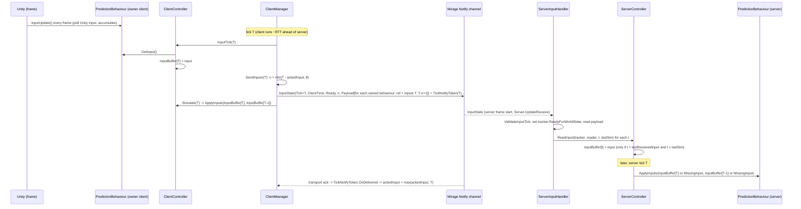

# 03 - Inputs and Server Input Handling

**Summary.** Inputs are **tick-addressed**: the client stamps the input it samples for client tick T, applies it locally at T, and sends it to the server which applies it at *server tick T*. The client keeps a 64-entry ring buffer per owned behaviour, and each tick sends one `InputState` message on Mirage's Notify channel carrying *every input since the last tick the server acknowledged* (max 8) for *all* owned behaviours. The server holds received inputs in a per-behaviour ring buffer, consumes exactly one per tick, and substitutes `MissingInput` (default: repeat the last valid input) for gaps. This pipeline is mostly per-object and independent of the snapshot/delta machinery.

## 1. End-to-end flow



## 2. Client side

### 2.1 Gathering
- Per frame, before ticks: `IPredictionUpdates.InputUpdate()` on every behaviour (`Assets/source/Runtime/PredictionManager.cs:203-207,275-295`). User code polls Unity input and stores it (Example3 accumulates press events and keeps latest axes, see file 02).
- Per tick, for behaviours where `UseInputs()` is true (owner client): `ClientController.InputTick(tick)` calls `behaviour.GetInput()` and does `_inputBuffer.Set(tick, input)` (`Assets/source/Runtime/ClientManager.cs:400-406`, `Assets/source/Runtime/ClientController.cs:86-99`). It logs a warning if ticks are not consecutive (`ClientController.cs:90-92`), which will happen after a client tick skip (`ClientTickRunner.OnTickSkip`).
- Debug hook: if the behaviour implements `IDebugPredictionLocalCopy`, the input is also applied to a non-networked copy object (`ClientController.cs:97-98`; used by Example1/2 to compare against a "no network" cube).

### 2.2 Local application
`ClientController.Simulate(tick)` -> `ApplyInputs(new NetworkInputs<TInput>(buffer[tick], buffer[tick-1]))` using `GetOrDefault` (default struct if the slot is empty), then `NetworkFixedUpdate()` (`ClientController.cs:74-84`). The same buffered inputs are used when the tick is replayed during resimulation, so a replay is exactly the client's own history of inputs; the client never learns which inputs the server *actually* used (e.g. substituted `MissingInput`).

### 2.3 Sending
`ClientManager.SendInputs(tick)` (`ClientManager.cs:418-430`):
- If `ackedInput` is null (start, or after a tick skip) it is set to `tick - 1` so only the new input is sent (`:423-424`).
- `ReadyForWorldState` true -> `SendReadyInputs`; false -> `SendNotReadyInputs` (header only, `Ready=false`, `:477-490`).

`SendReadyInputs` (`:432-475`):
1. `numberOfTicks = tick - ackedInput`; `length = min(numberOfTicks, MAX_INPUT_PER_PACKET = 8)` (`:438-440`, constant at `:50`). The `Debug.Assert(tick > ackedInput)` (`:436`) says new input must not have been acked before it was sent.
2. Open a pooled `NetworkWriter`. For each owned behaviour (`UseInputs()`), write `writer.WriteNetworkBehaviour(nb)` (packed NetId + 1 byte component index, `Mirage/Runtime/Serialization/MirageTypesExtensions.cs:11-29`) then `length` inputs, newest first: `t = tick - j` for `j in 0..length-1`, each via `ClientController.WriteInput` -> `writer.Write(buffer.GetOrDefault(t))` (`ClientManager.cs:446-461`, `ClientController.cs:101-105`).
3. Message: `InputState { Ready = true, Tick = tick, ClientTime = _time.UnscaledTime, NumberOfInputs = length, Payload = writer.ToArraySegment() }` (`:463-470`).
4. `var token = TickNotifyToken.GetToken(this, tick); _clientPlayer.Send(message, token);` (`:472-473`) - this is Mirage's **Notify** channel (unreliable, ordered-ignoring-late, delivered/lost callback; `Mirage/Runtime/NetworkPlayer.cs:298-325`).

### 2.4 Redundancy = ack-driven
`ClientManager` implements `ITickNotifyTracker` (`ClientManager.cs:55-66`). When Mirage reports a packet delivered, `TickNotifyToken.OnDelivered` calls `SetLastAcked(tick)` which keeps the **maximum** acked tick (`ITickNotifyTracker.cs:36-46`). So each packet re-sends every input since the last packet the server is known to have received; with an RTT of R ticks it carries about `R+1` inputs, capped at 8 (about 160 ms at 50 Hz). Lost packets are ignored (`OnLost` only recycles the token, `:48-51`); the following packet simply still contains the unacked inputs. If more than 8 ticks are unacked, inputs older than 8 ticks are never re-sent.

`OnTickSkip` (client re-synchronised to the server clock) sets `ackedInput = null` (`ClientManager.cs:121-128`).

### 2.5 Readiness
`SendNotReadyInputs` is effectively unreachable: `SetClientReady(ready)` sets `ReadyForWorldState` and `TickRunner.SetRunning(ready)` together (`PredictionManager.cs:250-254`), and `Tick` (and therefore `SendInputs`) only runs when the tick runner is running. So the client never tells the server it is no longer ready (inferred from wiring, not tested). The first message the client sends is already a Ready message (with `AutoStart`).

## 3. Server side

### 3.1 Receive path
`ServerManager.HandleInput` forwards to `ServerInputHandler.HandleInput(player, message, _lastSim)` (`Assets/source/Runtime/ServerManager.cs:91-94`). It runs in the frame's `BeforeAllTicks` (`Server.UpdateReceive`, `PredictionManager.cs:129`), so inputs arrive *between* ticks. `_lastSim` is the last tick the server finished simulating.

`HandleInput` (`Assets/source/Runtime/ServerInputHandler.cs:33-47`):
1. `tracker.LastReceivedClientTime = max(prev, message.ClientTime)` - done first, before any validation, trusting the client's wall-clock stamp (echoed back for RTT measurement).
2. `ValidateInputTick(tracker, message.Tick, lastSimTick)`; if false, return (nothing else is updated, including `ReadyForWorldState`).
3. `tracker.ReadyForWorldState = message.Ready`.
4. If `Ready`: `HandleReadyInput`.
5. `tracker.lastReceivedInput = max(old, message.Tick)`.

### 3.2 Validation (`ValidateInputTick`, `ServerInputHandler.cs:81-106`)
| Case | Condition | Result |
|---|---|---|
| Out of order | `tracker.lastReceivedInput > tick` | dropped; comment: input[n+1] already contains input[n] (`:83-90`) |
| Early or on time | `tick >= lastSimTick` | accepted (`:92-96`); no upper bound on how early |
| Late | `tick < lastSimTick` | dropped; logs "Late"; if it was the very first message the log says it's expected (`:98-104`) |

Note the message-level test is `>= lastSimTick` but the per-input test (below) is `> lastSim`, so a message stamped exactly `lastSimTick` passes and then contributes nothing.

### 3.3 Reading the payload (`HandleReadyInput`, `:49-79`)
```
while (reader.CanReadBytes(1)):
    networkBehaviour = reader.ReadNetworkBehaviour()         // null -> warn and abandon rest of message
    if player != networkBehaviour.Owner  -> throw InvalidOperationException
    if !(networkBehaviour is IPredictionBehaviour) -> throw InvalidOperationException
    for i in 0..NumberOfInputs-1:  ServerController.ReadInput(tracker, reader, message.Tick - i, lastSimTick)
```
- The owner check is the only authorization (`:65-66`); the handler's exception is logged by Mirage and does **not** disconnect the sender because the server's `MessageHandler` is created with `disconnectOnException: false` (`Mirage/Runtime/NetworkServer.cs:309`).
- `HasInput` is not checked; a client naming one of its own input-less behaviours would hit a null `_inputBuffer` (not tested; the guard `inputTick > ...` is evaluated first, so it depends on timing).
- Each input is always deserialized (`reader.Read<TInput>()`, `ServerController.cs:49`) even when discarded, to keep the reader aligned.

### 3.4 Buffering (`ServerController.ReadInput`, `Assets/source/Runtime/ServerController.cs:47-56`)
```csharp
var input = reader.Read<TInput>();
if (inputTick > tracker.lastReceivedInput && inputTick > lastSimulation)
{
    lastReceived = tracker.lastReceivedInput;
    _inputBuffer.Set(inputTick, input);
}
```
- Only inputs newer than anything seen in earlier *messages* and not yet simulated are stored. Because `tracker.lastReceivedInput` is advanced only after the whole message is processed (`ServerInputHandler.cs:46`), all inputs of one message are compared against the previous message's tick, so redundant older inputs are accepted if they fill gaps.
- Ring buffer = `NullableRingBuffer<TInput>(64)` indexed by `tick % 64` with **no tick tag** (`RingBuffer.cs:36-42`). There is no upper limit on `inputTick`, so a client that stamps ticks far ahead (or a bug) can overwrite slots of other ticks and, worse, push `tracker.lastReceivedInput` far into the future, after which every later honest message is rejected as "out of order" until the server clock catches up (reasoned from `ServerInputHandler.cs:46,85`; not tested). Since the server consumes only one input per tick, a client cannot speed up its own simulation, but it can stall itself or desync its prediction.
- `lastReceived` is a non-null marker meaning "some input has been accepted for this behaviour" (it is set to the tracker's previous `lastReceivedInput`, which is non-null whenever the `>` test can be true).
- **First-packet quirk (benign):** while `tracker.lastReceivedInput` is still `null`, `inputTick > null` is `false` in C#, so the very first message's inputs are dropped and only then does `lastReceivedInput` become non-null (`ServerInputHandler.cs:46`). One tick of input is lost at start (because the first message is a Ready message, since the not-ready path is unreachable).

### 3.5 Consumption (`ServerController.Tick`, `ServerController.cs:58-78`)
```
if UseInputs():
    if hostMode && HasAuthority: inputBuffer[tick] = GetInput()          // host player
    getValidInputs(tick, out input, out previous)
    ApplyInputs(new NetworkInputs(input, previous))
NetworkFixedUpdate()
if UseInputs(): inputBuffer.Clear(tick - 1)
```
`getValidInputs` (`:80-95`): until the first input has been accepted (`lastReceived == null`) and not host, both `input` and `previous` are `default(TInput)` (ApplyInputs still runs with zero input). Otherwise `getValidInput(tick)` and `getValidInput(tick-1)`; if the current one was present it becomes `lastValidInput = (tick, input)`.
`getValidInput` (`:97-105`): `TryGet` from the ring; if empty -> `behaviour.MissingInput(lastValidInput.input, lastValidInput.tick, tick)`.

Properties worth knowing:
- `MissingInput` is called for the *current* tick and again for the *previous* tick on the next call (so up to twice per missing tick), and must be pure. Default returns the previous valid input (`PredictionBehaviour.cs:84-93`), which keeps held keys held, and because both `Current` and `Previous` are the same substituted value, edge-triggered actions (`Jump && !Previous.Jump`) will not fire spuriously.
- `Clear(tick - 1)` is done after the tick, so `Previous` is still available for tick T; stale inputs for ticks that were never consumed (e.g. while `UseInputs()` was false) are not cleared and could be misread 64 ticks later (slots are untagged). Edge case, not observed.
- There is no input *jitter buffer* on the server: input for tick T is consumed at tick T if present; otherwise substituted. The client's lead (time sync) is what keeps inputs early; the server has no feedback to the client about lateness other than the RTT/clock mechanism (file 07 and the timing file).
- The server does not ack or report which inputs it used. Transport-level ack (Notify delivered) is the only feedback, and a *late* packet is acked by the transport even though `ValidateInputTick` discards it; the client then stops re-sending those inputs and the server substitutes `MissingInput` for them, which shows up as a misprediction on the client.

### 3.6 Host mode
The host's own input never goes through `InputState`: `ServerController.Tick` calls `GetInput()` directly (`ServerController.cs:64-67`). `IServerController.ReceiveHostInput<T>` is declared and implemented but has no callers (`ServerController.cs:107-120`, `Interfaces.cs:107`).

## 4. Message format and size (see file 07 for the full table)

`InputState` (`Assets/source/Runtime/Messages.cs:49-66`): `int Tick` (32 bit), `double ClientTime` (64 bit), `bool Ready` (1 bit), `int NumberOfInputs` with `[BitCountFromRange(1,8)]` (3 bits), `ArraySegment<byte> Payload` (count-plus-one packed + bytes). Mirage adds a 2-byte message id (`MessagePacker.ID_BYTE_SIZE = 2`) and the Notify packet header is 13 bytes (`AckSystem.SEQUENCE_HEADER`, `Mirage/Runtime/SocketLayer/Connection/AckSystem.cs:12`).

Rough size for Example3's player (two owned behaviours): per behaviour a 2-byte reference (NetId < 241) plus `L` inputs; `PlayerMove` input = 1 bit + `Vector2` (2 floats), `PlayerLook` input = 1 bit + 2 floats, so about 8.1 bytes each, assuming raw 32-bit floats. With `L ~ 6` (about 100 ms RTT at 50 Hz): payload about `2*(2 + 6*8.1) ~ 101 B`, message about `16 + 101` B, plus Notify header 13 B: roughly 130 B per packet, 50 packets/s: **about 6.5 KB/s upstream per client (estimate, not measured)**. Because the payload scales with RTT (up to 8 inputs), high-latency clients send larger packets.

Frequency: one `InputState` per client tick (default 50/s), always, even if nothing changed.
Channel: Notify (`INetworkPlayer.Send(msg, INotifyCallBack)`). Max Notify payload is `UdpMTU.MaxPacketSize (1280-48=1232) - 13 = 1219` bytes; the client does not check this, and `AckSystem.SendNotify` throws `MessageSizeException` for oversize messages (`AckSystem.cs:314-318`), which `NetworkPlayer.Send` does not catch (it only handles `BufferFullException` and `NoConnectionException`, `NetworkPlayer.cs:312-324`), so an input message with many large inputs would throw out of `ClientManager.Tick` (reading-based; unlikely with small inputs).

## 5. Summary of guarantees / non-guarantees

| Topic | Behaviour |
|---|---|
| Ordering | Inputs addressed by tick; the server consumes one per tick in tick order regardless of arrival order. |
| Loss | Re-sent until a packet containing them is acked (max 8 behind). |
| Duplication | Harmless: stored by tick; per-input `> lastReceivedInput` test. |
| Late | Dropped silently (log only); substituted by `MissingInput`. |
| Early | Accepted without limit; ring wrap/poisoning risk beyond 64 ticks. |
| Missing | `MissingInput(prev, prevTick, curTick)`; default = repeat last valid. |
| Authority | Owner check per behaviour; exception (no disconnect) otherwise. |
| Rate limiting | None in CSP (Mirage's per-player error rate limit only covers errors). |
| Client feedback | Only transport ack; no "your input was late/ignored/substituted" signal. |
