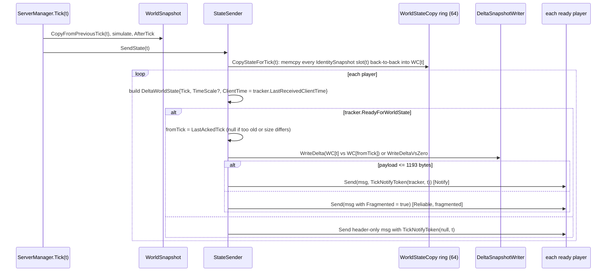

# 04 - State, Snapshots and Delta Snapshots

**Summary.** All predicted state lives in manually allocated unmanaged memory: one block per `NetworkIdentity` holding 64 consecutive ticks of `{header, behaviour state, behaviour state, ...}` as raw `int`s. Each simulated tick the previous slot is `memcpy`'d forward and every behaviour's `State` pointer is re-pointed at the new slot. The server concatenates the slots of *all* identities into one flat `WorldStateCopy` per tick, delta-compresses it as raw `int` differences against the last tick the client acknowledged, and sends it to every ready client. The client decodes into its own `WorldStateCopy` ring and `memcmp`s each identity's block against its prediction. This design forces `TState` to be a fixed-size, blittable, explicitly laid-out struct.

## 1. Memory layout

```
IdentitySnapshot (one per NetworkIdentity that has >=1 ISnapshotBehaviour)      WorldSnapshot.cs:119
one AllocHGlobal block = IntSizePerTick * TickBufferSize(64) * 4 bytes           WorldSnapshot.cs:183-195

slot(t) = base + (t % 64) * IntSizePerTick ints                                  WorldSnapshot.cs:248-253
          +--------------------+-----------------------+-----------------------+----
          | Header (2 ints)    | behaviour 0 state     | behaviour 1 state     | ...
          | NetId, IntSize     | AllocationSizeInts[0] | AllocationSizeInts[1] |
          +--------------------+-----------------------+-----------------------+----
          ^ slot base          ^ PtrIntOffset = 2       ^ PtrIntOffset = 2 + n0

Header = [StructLayout(Explicit, Size = 8)] { uint NetId @0; int IntSize @4 }    WorldSnapshot.cs:271-279
AllocationSizeInts = (sizeof(TState) + 3) / 4   (round up to a 32-bit multiple)  SnapshotBehaviour.cs:86
```

- The header is written into **all 64 slots** at allocation time because the first tick is unknown (`SetHeader`, `WorldSnapshot.cs:197-214`); `CopySnapshot` copies it forward with the state each tick.
- Behaviours are laid out in `identity.NetworkBehaviours` order filtered to `ISnapshotBehaviour` (`GetBehaviourCache<ISnapshotBehaviour>.GetBehaviours`, `PredictionCollection.cs:29-40`; offsets assigned in `IdentitySnapshot.calculateIntSize`, `WorldSnapshot.cs:167-181`). Server and client must therefore have the same behaviours and the same `sizeof(TState)` for every identity; the client only *logs an error* on mismatch and then copies `snapshot.IntSizePerTick` ints anyway (`ClientManager.cs:237-248`).
- `SnapshotBehaviour<TState>` exposes `_statePtr` (`TState*`) and `ref TState State` (`SnapshotBehaviour.cs:41-59`). The interface `ISnapshotBehaviour` adds `AllocationSizeInts`, `PtrIntOffset`, `SnapshotManager` (the owning `IdentitySnapshot`), used by `GetStateAtTick(tick)` (`:16-39,61-66`).
- Ring slots are **not tagged** with the tick they hold. Whether slot `t % 64` currently contains tick `t`, `t-64`, or never-written zeros is only known by call discipline.
- `OffsetForTick` uses plain `%` so a negative tick would index before the allocation (unlike `RingBuffer.IndexToBuffer`, which wraps negatives, `RingBuffer.cs:36-42`). Ticks start at 1 on both sides so this is latent only.

### 1.1 The "active pointer" mechanism
`WorldSnapshot.CopyFromPreviousTick(tick)` (`WorldSnapshot.cs:91-103`): for every identity `CopySnapshot(tick-1, tick)` (memcpy of the whole block including header, `:224-229`) and `SetActivePtr(tick)` (re-point each behaviour, `:231-238`). It is called at the start of every server tick (`ServerManager.cs:145`), every client `Simulate` (`ClientManager.cs:352`) and therefore every resim step. `WorldSnapshot.SetActivePtr(tick)` alone is used to jump the whole world to a given tick (`ClientManager.cs:317`).

Consequences:
- `State` in user code always means "state of the tick currently being simulated"; cost is O(total world ints) per simulated tick, per resim step.
- State is mutated **in place** in the ring (`State.Health -= v`, `ref State.GroundedTimer`), so the history of past ticks *is* the ring; there is no separate "history" structure.
- A despawn nulls the pointers (`IdentitySnapshot.Ptr` setter -> `SetActivePtrNull`, `WorldSnapshot.cs:130-141,240-246`); later `State` throws `SnapshotException` (`SnapshotBehaviour.cs:68-71`).

## 2. Server: capture and send



Code: `StateSender.SendState` `Assets/source/Runtime/StateSender.cs:69-91`; `CopyStateForTick` `:93-132`; `SendPayload` `:135-159`; `FragmentSend` `:161-169`; `HandleFragmentedAck` `:171-175`; `CalculateFromTick` `:227-254`; `SendNoPayload` `:256-262`; `CreatePayload` `:264-284`.

Details:
- **`WorldStateCopy`** (`DeltaSnapshot/WorldStateCopy.cs:14-41`): an `IHasAllocatedPointer` holding an `int*` and `IntSize`; `CheckSize` frees and re-allocates (zeroed) whenever the size changes. The server keeps `RingBuffer<WorldStateCopy>(64)` pre-filled with new instances (`StateSender.cs:60-61`). If there are no snapshots at all `CopyStateForTick` returns without touching the copy (`:97-98`).
- **Order**: identities appear in `_worldSnapshot.Snapshots` list order (spawn order, `WorldSnapshot.cs:28,48,70`). The client does not depend on order (it walks headers), but the *delta* does depend on the layout being unchanged between base and target tick.
- **Base tick**: `fromTick = tracker.LastAckedTick`, discarded (-> send full vs zero) if `tick - fromTick >= 64` or if `WorldStateCopy.IntSize` differs between base and target (`StateSender.cs:227-254`). **Every spawn or despawn changes the total size, so for roughly one RTT after each spawn/despawn every ready client is sent a full vs-zero state every tick** until a post-change tick is acked (reasoned from `:240-250`; not measured). With a large world a vs-zero state exceeds the Notify limit (next bullet), so those ticks go out as reliable fragmented messages.
- **Size limit**: `MAX_NOTIFY_SIZE = 1219 - MESSAGE_HEADER(26) = 1193` bytes of delta payload (`StateSender.cs:27-28`; 1219 = `UdpMTU.MaxPacketSize 1232 - Notify header 13`). Larger payloads set `msg.Fragmented = true` and are sent **reliable** (Mirage fragmentation, `:161-169`); the client replies with `DeltaWorldStateFragmentedAck{Tick}` and the server then treats that tick as acked (`ClientManager.cs:159-162`, `StateSender.cs:171-175`). The code comment "we can then mark this tick as acked because client will 100% get it" (`:169`) is not what the code does (it waits for the explicit ack message). The reliable path suffers head-of-line blocking and retransmits, which is the opposite of what a state stream wants.
- **Per-player work**: the payload is rebuilt per player (`StateSender.cs:140` has a todo to cache by `(fromTick, tick)`); a single `NetworkWriter(1300)` is reused (`:62,266`).
- **Ready handshake**: payload only when `tracker.ReadyForWorldState` (set from the client's `InputState.Ready`); otherwise a header-only message carrying time-sync info (`:84-89,256-262`). No interest management: all identities with snapshot behaviours go to all ready players.
- `TimeScale` is `Time.timeScale` if != 1 else null; sent every tick (`:81`).
- Debug: `LogValueTracker` averages payload sizes and logs every 60 ticks (`:177-194`); `WorldStateDump.ToFile` dumps the first `_dumpToFileCount` ticks (hard-coded 0, `:45-46,128-131`).

### 2.1 Ack tracking
`PlayerTimeTracker.LastAckedTick` is advanced by `TickNotifyToken.OnDelivered` (Notify packet acked by the client's transport) or by the fragmented-ack message, always `max(old, new)` (`PlayerTimeTracker.cs:22-34`, `ITickNotifyTracker.cs:36-46`). Notes:
- Mirage acks late Notify packets at the transport level but drops them before the handler (`AckSystem.ReceiveNotify` returns `default` for `distance <= 0`, `Mirage/Runtime/SocketLayer/Connection/AckSystem.cs:454-475`, while `ProcessIncomingHeader`/`SetAckValues` still set the ack bit for late packets, `:562-598`). Because `LastAckedTick` only moves up, the highest acked tick is always one the client application processed, so using it as a delta base is safe (reasoned, not tested).
- The client also drops states with `lastReceivedTick > msg.Tick` (`ClientManager.cs:164-168`) *after* the transport has acked them; same reasoning applies.
- `ITickNotifyTracker.ClearLastAcked()` is implemented but never called anywhere (`ClientManager.cs:63-66`, `PlayerTimeTracker.cs:31-34`).

## 3. Delta codecs (`DeltaSnapshot/DeltaSnapshot.cs`)

`IDeltaSnapshot { WriteDelta(writer, intSize, from*, to*); ReadDelta(reader, intSize, from*, to*) }` (`:29-33`). `DeltaSnapshotWriter` wraps one codec (default `DeltaSnapshot_ValueZeroCounts`, `:43`) and adds `WriteDeltaVsZero/ReadDeltaVsZero` using a zeroed `WorldStateCopy` of the right size (`:46-69`; it re-validates the zero buffer element-by-element on every call even in release builds, `:52-56`). All codecs operate on the world as a flat `int[]`, taking `to[i] - from[i]` (wrapping int subtraction on the raw bit patterns, so float changes become "ULP distance" integers).

| Codec | Lines | Encoding | Status |
|---|---|---|---|
| `DeltaSnapshot_IntDiffPack` | `:143-175` | 1 bit "changed" per int + `PackedInt32(diff)` | works; self-described "bad, but was quick to write" |
| `DeltaSnapshot_ZeroCounts` | `:181-254` | alternating `PackedUInt32(zeroRun)`, `PackedInt32(diff)` | works |
| **`DeltaSnapshot_ValueZeroCounts`** (default) | `:260-378` | first all run-lengths of alternating zero/non-zero ints as `PackedUInt32`, then all non-zero diffs as `PackedInt32`; uses `stackalloc int[intSize]` (write) / `stackalloc bool[intSize]` (read) | used in production path |
| `DeltaSnapshot_FloatFocus` | `:383-461` | per int: zero flag; zigzag; "likely float" flag; low 16 bits raw + `VarIntBlocksPacker` for the rest. Lossless. | works per tests |
| `DeltaSnapshot_LossyFloats` | `:466-652` | experiment; `WriteDelta` -> `WriteDelta_fr` which logs and `return`s before writing anything (`:549`) | unfinished; still listed in the test fixtures (`Assets/Tests/DeltaSnapshotTest.cs:9-14`), so that fixture cannot round-trip by reading |
| `DeltaSnapshot_LossyFloats_Easy` | `:657-698` | quantises float diffs by `*10_000`; "LOSSY dont use on ints" | works; unsafe for mixed state |
| `DeltaSnapshot_FromObject` | `:703-795` | per-object "changed" flag + packed diffs | unused experiment; first-pass indexing bug (`delta[j]` instead of an offset, `:728`) |

`PackedInt32` is Mirage's zigzag + variable-length: values <= 240 take 1 byte, <= 2287 take 2, <= 67823 take 3, larger take 1 + n bytes (`Mirage/Runtime/Serialization/Packers/PackedExtensions.cs:9-72`). So a changed float whose bit pattern moved by a few thousand ULPs costs 2-3 bytes; a large change costs up to 5 bytes. The header ints (`NetId`, `IntSize`) never change so they fall into zero-runs.

Tests: `Assets/Tests/DeltaSnapshotTest.cs` covers round trip, a bandwidth log, and quaternion packing for the six codecs; there are no tests of `StateSender`, `ClientManager.ReceiveDeltaWorldState` or the ack logic.

Not implemented: `HoffmanCoding` is an empty class with a commented stub (`DeltaSnapshot/HoffmanCoding.cs:10-18`; "Need hoffman coding too!" `DeltaSnapshot.cs:26`); `StateReceiver` is an empty class (`StateSender.cs:343-346`).

## 4. Client: receive, store, compare

`ClientManager.ReceiveDeltaWorldState(player, msg)` (`Assets/source/Runtime/ClientManager.cs:157-190`):
1. If `msg.Fragmented`, send `DeltaWorldStateFragmentedAck{Tick}` (`:159-162`).
2. Drop if `lastReceivedTick > msg.Tick` (`:164-168`).
3. Mirror server time scale into `UnityEngine.Time.timeScale` (`:170-178`).
4. If `msg.DeltaState.Array != null` (payload present): `ReadDeltaFromMessage(msg)` then `CopyStateForTick(msg.Tick)` (`:180-186`).
5. Always: `clientTickRunner.OnMessage(msg.Tick, msg.ClientTime)` (time sync) and `_clientInterpolation.OnMessage(msg.Tick)` (`:188-189`).

`ReadDeltaFromMessage` (`:192-209`): `toCopy = _worldStateCopy.GetOrDefault(msg.Tick)`, `toCopy.CheckSize(alloc, msg.StateIntSize)`, then `ReadDelta(reader, toCopy.IntSize, fromCopy.Ptr, toCopy.Ptr)` where `fromCopy = _worldStateCopy.GetOrDefault(msg.VsTick)` (or vs zero if `VsTick` is null). The client **trusts the server's `VsTick`**: nothing checks that the base slot was ever populated or has the same size, and a null `Ptr` would be dereferenced in unsafe code (native crash rather than exception). In normal operation the server only chooses ticks the client acked.

`CopyStateForTick(tick)` (`:211-259`): walk the decoded flat buffer using each block's header (`IntSize` step, error if `< 2` or `NetId == 0`, `:226-234`); for each block whose NetId exists in the client's `WorldSnapshot.LookUp`, `UnsafeHelper.CopyAndCheckChanged(readPtr, clientSlot(tick), snapshot.IntSizePerTick)` (memcmp, copy only if different, `:244-245`; `WorldSnapshot.cs:291-302`); unknown NetIds are skipped with a warning (`:250-253`). `lastReceivedTick = tick` (`:215`) and `_needResimulate = anyChanged` (`:258`). Note it **overwrites the client's predicted slot for that tick** with the server's, so the ring holds the authoritative state for the latest received tick and predicted state elsewhere.

## 5. `Alloc/` and unmanaged memory

- `IAllocator { Allocate(IHasAllocatedPointer owner, int byteCount); Release(owner); IDisposable }`, `IHasAllocatedPointer { string name; void* Ptr }` (`Alloc/IAllocator.cs:9-25`). The allocator writes the pointer into the owner and the owner clears dependents when it is nulled.
- `SimpleAlloc` (`Alloc/SimpleAlloc.cs:102-194`): `Marshal.AllocHGlobal`, zero with `AllocHelper.ZeroMemory`, remember in a `Dictionary<IHasAllocatedPointer, Allocation>`; `Release` frees and nulls; `ReleaseAll`/`Dispose`/finalizer free everything. In DEBUG builds each allocation is scanned to check it is zeroed (`:126-128,137-148`). `Allocate(int)` without owner is for tests.
- `AllocHelper.ZeroMemory` P/Invokes `memset` from `msvcrt.dll`/`libc` on Windows/Linux/macOS (editor + standalone) and falls back to a byte loop elsewhere (`Alloc/AllocHelper.cs:21-56`; modified 2023 by a contributor, header lines 9-10).
- Ownership: one `SimpleAlloc` per `PredictionManager`, shared by server and client managers (`PredictionManager.cs:62,84,110`). Allocations: one per `IdentitySnapshot`, one per `WorldStateCopy` (64 on the server, 64 on the client, plus a zero buffer in each `DeltaSnapshotWriter`). `WorldStateCopy`s are never explicitly released on stop (they stay in the allocator until `OnDestroy`).
- Lifetime hazards inherent in the approach: pointers handed out by `State`/`StatePtr`/`GetStateAtTick` dangle after despawn (freed next frame via `Cleanup`, `PredictionManager.cs:327-328`) and `IdentitySnapshot.Ptr` nulling is the only protection.

## 6. Requirements the design places on user state

1. `TState : unmanaged` (compile-time) - fields only of blittable value types.
2. **No `bool`.** Use `NetworkBool` (1-byte, explicit layout; `Utils/NetworkBool.cs:11-35`; the doc says bool representation may differ between machines) or `CompoundBool` for bitfields.
3. **Explicit, deterministic layout and size**: `[StructLayout(LayoutKind.Explicit, Size = N)]` and `[FieldOffset]` (Example1 24 B, Example2 52 B, Example3 44 B). The state bytes are compared with `memcmp`, delta'd as `int`s and shipped between possibly different compilers/platforms, so padding and field order must not differ. `Update-beta5.md` says this is a requirement. Padding bytes must remain zero or they cause permanent "mismatches" (the code never masks them).
4. **Fixed size.** Size is baked into the snapshot layout per behaviour type; variable-length data (lists, inventories) must be expressed as fixed slots.
5. Size is rounded up to 4 bytes (`SnapshotBehaviour.cs:86`); everything is handled as `int[]`. The 1-byte `NetworkBool` costs a whole int if it is the only field.
6. Bitwise equality: any float noise, `-0f` vs `0f`, or NaN payload difference counts as a misprediction and triggers a full-world resim (file 05). Cross-machine floating-point determinism of the simulation therefore directly drives resim frequency.
7. Identical behaviour set and struct size on server and client prefabs per identity (only logged on mismatch).
8. State is only meaningful via the active slot: write it from inside the tick (`ApplyInputs`/`NetworkFixedUpdate`/`AfterTick`/`OnPredictionSetup`); writing from elsewhere edits whichever tick slot is active.
9. Everything in the state is sent to **all** clients (no per-owner or per-visibility fields).
10. A single state struct per behaviour: there is no per-field delta, quantisation, or send-rate control other than the codec choice (global) - so e.g. a rarely-changing field costs nothing but a frequently-changing 32-bit float costs 2-5 bytes per tick per client.

## 7. Cost estimates (illustrative, not measured)

Using Example3's player (PlayerLook 44 B + PlayerMove 44 B + header 8 B = 96 B/tick/identity):
- Memory per identity: 96 B * 64 = 6.1 KB for the snapshot ring (x2 for server+client in host/single-process), plus its share of the `WorldStateCopy` rings (64 * world size on server and on client). For 32 players the world is about 3 KB, so each ring is about 200 KB: total on the order of 1 MB. Memory is **not** the problem.
- CPU per tick: memcpy of the world forward (3 KB), copy into `WorldStateCopy` (3 KB), then per player a diff scan of 3 KB plus encode (32 players -> ~100 KB scanned). Also small. The expensive part is resimulation (file 05), not snapshot handling.
- Bandwidth: with all 32 players moving, about 7 changed ints per player per tick (position, velocity, grounded timer) at ~3-5 B each is about 0.7-1.1 KB per tick per client plus run-length overhead (~0.1-0.2 KB), i.e. **roughly 40-60 KB/s per client and 1.5-2 MB/s total server upstream at 32 clients**. The delta base is ~RTT old (not 1 tick old), which makes diffs larger than a tick-to-tick delta. This sits right at the 1193-byte Notify limit, beyond which the code falls back to reliable fragmented sends (see section 2). Treat these as order-of-magnitude figures; the repo's own `BandwidthTest` logs numbers but none are recorded.

## 8. Things that look fragile here
- No schema/version check between server and client layouts beyond a logged size mismatch (`ClientManager.cs:239-242`).
- Spawn/despawn churn causes vs-zero resends (section 2) and shifts every later identity in the flat buffer; a networked projectile per shot would be costly in this scheme (Example3 deliberately keeps bullets non-networked).
- Unsafe pointer arithmetic everywhere; errors become native crashes or silent corruption, not exceptions.
- State is global and untagged: no way to ask "is slot X valid for tick T?"
- Two parallel copies of the same data (identity ring + `WorldStateCopy` rings) on both sides, with separate sizing rules (`CheckSize` re-allocation) and no shared abstraction.
