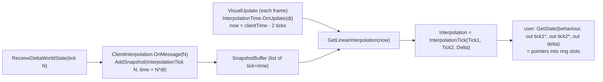

# 06 - Interpolation and Remote Objects

**Summary.** On a client, objects the player does not own are still full `PredictionBehaviour`s: their state is overwritten by each received world state, they are rolled back and replayed with everything else, and (unless user code extrapolates) they sit **frozen at the last server state, i.e. about one client-lead (RTT + margin) in the past**. `ClientInterpolation` is the library's attempt at snapshot interpolation for such objects: it records which server ticks have arrived and hands user code pointers to two ring slots to blend. By reading, the feature is unfinished: its clock is never synchronised to server time, its tick-pair lerp always returns `Tick2 = 0`, no example uses it, and the snapshot list is never pruned in practice.

## 1. How a non-owned object is treated by the client today

All of the following apply to any `PredictionBehaviour` where `UseInputs()` is false on the client (`HasInput == false` or `HasAuthority == false`, `PredictionBehaviour.cs:195-216`):

1. **State arrives in the ring.** Each `DeltaWorldState` overwrites slot N of the object's `IdentitySnapshot` if it differs from the client's stored value (`ClientManager.CopyStateForTick`, `Assets/source/Runtime/ClientManager.cs:244-245`).
2. **It pushes to Unity only through a rollback.** Pushing state into the `Transform`/`Rigidbody` is the user's `AfterStateChanged`, which runs at the start and end of each resim (`ClientManager.cs:319-326`, `ClientController.cs:55-68`). In normal operation a resim happens (almost) every tick, so the object is repositioned at about the tick rate (50 Hz default) to server state N, regardless of the display frame rate. Between resims nothing moves it unless user code does.
3. **It is simulated like everything else.** `NetworkFixedUpdate()` runs for it every tick and every replayed tick (`ClientManager.cs:358-362`); the `IsRemoteClient` property exists so user code can special-case puppets (`PredictionBehaviour.cs:62`). With no input available for it, the usual implementation is "do nothing", which holds the object at state N for the remainder of the replay; `MovingTarget` explicitly returns early on clients (`Example3/Scripts/MovingTarget.cs:23-24`).
4. **Time offset consequence.** Because the local player is simulated up to tick T-1 while the remote objects are at N (T-1-N = roughly the client lead), the local player collides with, shoots at, and sees remote objects as they were `lead` ticks ago (reasoned from `ClientManager.cs:388-394`). This is the usual "predicted self + interpolated/past others" split, but here it is implicit and the past-ness is un-smoothed.
5. **Mirage's own sync is bypassed.** CSP does not use SyncVars or `NetworkTransform` for these; the position is only whatever the user copies from `State`.

None of Example1-3 interpolate remote objects: `grep` for `ClientInterpolation`, `TryGetInterpolation` and `GetState(` in `Assets/Example*` finds nothing.

## 2. `ClientInterpolation` (`Assets/source/Runtime/ClientInterpolation.cs`)

Namespace layout: lines 19-428 are in `JamesFrowen.PositionSync` (code lifted from the author's PositionSync package: `InterpolationTime`, `ISnapshotInterpolator<T>`, `SnapshotBuffer<T>`), lines 429-556 in `JamesFrowen.CSP`.

### 2.1 Wiring
- One instance per `ClientManager`, created in its constructor and added to the `PredictionCollection` as an `IPredictionUpdates` with `Order => int.MinValue` (`ClientManager.cs:99-100`, `ClientInterpolation.cs:463`), so its `VisualUpdate` runs first each frame. `InputUpdate`/`NetworkFixedUpdate` are empty (`:528-529`).
- Every spawned `PredictionBehaviour` receives a reference in `ClientSetup` (`PredictionBehaviour.cs:168-172`) exposed as `SnapshotBehaviour.ClientInterpolation` (`SnapshotBehaviour.cs:82`).
- `ClientManager.ReceiveDeltaWorldState` calls `_clientInterpolation.OnMessage(msg.Tick)` for **every** state message, including header-only messages with no payload (`ClientManager.cs:189`).
- Not available on the host (no `ClientManager`).

### 2.2 Data flow

- `OnMessage(tick)`: `serverTime = tick * FixedDeltaTime` (float); on first message first adds a sentinel `USE_LOCAL_STATE (-1)` at `serverTime - dt`; then adds `tick` (`ClientInterpolation.cs:495-504`).
- `VisualUpdate`: `_timeSync.OnUpdate(DeltaTime)`; `snapshotTime = _timeSync.Time`; `state = _buffer.GetLinearInterpolation(snapshotTime)`; `Interpolation = state`; prune snapshots older than `snapshotTime - ClientDelay*1.5` (`:506-526`).
- `GetState<TState>(behaviour, out tick1, out tick2, out delta)` (`:531-554`): `tick2 = behaviour.GetStateAtTick(interp.Tick2)`; `tick1 = (Tick1 == USE_LOCAL_STATE or null) ? behaviour.StatePtr : GetStateAtTick(Tick1)`; `delta = interp.Delta`. The two pointers point into the **same ring** that holds predictions; slot N holds server data only if message N arrived and has not been overwritten by replay (replay writes slots > N).
- `SnapshotBuffer<T>` (`:248-427`): sorted list; `GetLinearInterpolation(now)` returns first/last when `now` is outside the range, else lerps between the two bracketing snapshots; throws if snapshots are added out of order (`:301-302`).
- `InterpolationTime` (`:50-243`): EMA of `serverTime - clientTime` driving a +/-1% time-scale nudge, snapping if too far (`skipThreshold`), with a fixed `ClientDelay = tickInterval * 2` (`:134-149`). Default constructor values are used (no settings are plumbed from `PredictionManager`).

### 2.3 Why it cannot work as written (reading-based findings)

1. **The clock is never fed.** `InterpolationTime.OnMessage(serverTime)` is the method that initialises `_clientTime` and adjusts the scale, but nothing calls it: `grep` for `_timeSync` shows only `OnUpdate`, `Time`, `ClientDelay` (`ClientInterpolation.cs:508,518,524`). So `intialized` stays false and `_clientTime` is simply accumulated frame time since the object was created, starting at 0, while snapshots are stamped `tick * dt` (server uptime). Unless the server was started at the same moment as the client, `now` is below the first snapshot time, so `GetLinearInterpolation` takes the `First.time > now` branch (`:328-334`) and returns the first sentinel (`USE_LOCAL_STATE`) forever. The snapshot list (one entry per received state, ~50/s) is then never pruned (`RemoveOldSnapshots(now - 0.06)` removes nothing, `:524-525`) and `RemoveOldSnapshots` walks the whole list every frame (`:382-393`), so the cost grows without bound (reasoned; not run).
2. **`Tick2` is always 0.** The interpolator returns `new InterpolationTick(a.Tick1, a.Tick2, alpha)` (`:454`). `a` was created by the implicit `int -> InterpolationTick` conversion (`:448`), which leaves `Tick2 = 0`, so the "to" tick (should be `b.Tick1`) is lost. `GetState` then reads `GetStateAtTick(0)`, i.e. slot 0, as the "to" state.
3. **Null checks that cannot trigger.** `GetState` comments say `GetStateAtTick` "may return null if object didn't exist for tick1/tick2" (`:541-547`), but `IdentitySnapshot.GetStateAtTick` always returns a valid pointer into the ring (`WorldSnapshot.cs:255-260`); validity of a slot for a given tick is not tracked.
4. **Float tick-time.** `serverTime = tick * FixedDeltaTime` is computed in `float` (`:497`).
5. The author flags the initialisation logic as unverified: `// todo check this is correct` (`:175`).

Changelog entries show it as a feature added late: "adding Interpolation methods for client" (beta.12, 2022-12-11) and "adding helper method to get 2 states for interpolation" (beta.15, 2023-01-17), `Assets/source/CHANGELOG.md`.

## 3. What the examples do instead

- Example1/2: single owned object only, no remote objects of interest.
- Example3: remote player and target positions simply follow `AfterStateChanged` (`PlayerMove.cs:90-94`, `MovingTarget.cs:44-47`); no smoothing. The local camera uses a per-frame lerp toward the local player target in `LateUpdate` (`FollowLocalPlayer.cs`, `_lerp = 0.8`, frame-rate dependent) to hide the 50 Hz stepping of the local body.
- Example2 smooths *corrections of the local object* through `ResimulationTransition` (file 05), not remote objects.

## 4. Facts relevant to any future remote-object design
- The server sends state for every object to every client every tick (no interest management), so client-side buffers could in principle hold the last N server states of every remote object; today that history lives implicitly in the 64-slot ring and is only valid for ticks whose message arrived and which resim has not overwritten (slots > N are predictions).
- The client's time base for "how far in the past to render remote objects" is the tick clock, not a separate interpolation clock; the `DelayInTicks` computation (RTT + 2 stddev) is the quantity that determines how stale remote objects are at replay time (`TickRunner.cs:380-403`).
- Header-only messages (not ready) also create interpolation snapshots (`ClientManager.cs:189`) even though no state arrived for that tick.
