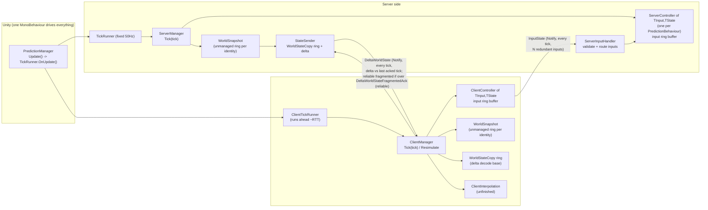

# ClientSidePrediction (CSP) - Research Report

**Subject:** James Frowen's `ClientSidePrediction` Unity library (package `com.james-frowen.clientsideprediction`, version `1.0.0-beta.19`, `Assets/source/package.json:4`), built on Mirage `157.0.0` (`Assets/source/package.json:13`), Unity 2022.3.
**Purpose of this report:** document how the current whole-world prediction + delta-snapshot design works, so that a much simpler per-network-object "SimpleCSP" can be designed for Mirage.
**Method:** static reading of every runtime source file and the three examples (about 6.5k lines in `Assets/source/Runtime/`). Nothing was compiled or run in Unity. Where behaviour is inferred rather than observed, the text says so. Line references are against the shallow clone at commit `f8bc7b5` ("fix: update package version").

## What the library is (one paragraph)

CSP is a **whole-world** client-side prediction system. Every networked object that derives from `PredictionBehaviour<...>` has a user-defined **unmanaged `TState` struct** that lives in a manually-allocated ring buffer (64 ticks by default) of **raw `int*` memory**, one ring per `NetworkIdentity`. The server simulates at a fixed tick rate (default 50 Hz) with `Physics.Simulate` driven by script, copies the state of **all** objects into one contiguous per-tick buffer, delta-compresses it against the last tick each client acknowledged (Mirage "Notify" channel) and sends one `DeltaWorldState` to every client every tick. Clients run ahead of the server by roughly one RTT, apply their own tick-stamped inputs locally, and every time a server state arrives that differs (bitwise) from what the client had predicted for that tick, the client **rolls the entire world back to the server state and re-simulates every tick up to "now"** (all objects, including physics). Inputs are tick-stamped and sent every tick on the Notify channel with ack-driven redundancy. A separate (incomplete) interpolation helper exposes two received world ticks for visual interpolation of remote objects.

## Files in this report

| File | What it covers |
|---|---|
| [`01-Architecture-and-Lifecycle.md`](01-Architecture-and-Lifecycle.md) | `PredictionManager`, `ServerManager`/`ClientManager`, per-object controllers, `PredictionCollection`; wiring into Mirage; per-tick call order on server and client (incl. resim); Unity callbacks; spawn/unspawn; host mode; global state. |
| [`02-PredictionBehaviour-API.md`](02-PredictionBehaviour-API.md) | The user-facing API: `PredictionBehaviour`, `NetworkInputs`, `IPredictionTime`, state/input struct rules, physics modes; Example1 and a detailed look at Example3 (FPS-like: move, look, shoot, health, bullet). |
| [`03-Inputs-and-Server-Input-Handling.md`](03-Inputs-and-Server-Input-Handling.md) | Gathering, buffering, sending (format, redundancy, channel), receiving, validating, missing/late/early input handling. |
| [`04-State-Snapshots-and-DeltaSnapshot.md`](04-State-Snapshots-and-DeltaSnapshot.md) | Unmanaged ring buffers, `WorldSnapshot`/`IdentitySnapshot`, `WorldStateCopy`, `StateSender`, delta codecs, ack/base-tick logic, `Alloc/`, memory-layout requirements on user state, cost estimates. |
| [`05-Reconciliation-and-Resimulation.md`](05-Reconciliation-and-Resimulation.md) | Misprediction detection (bitwise, whole world), rollback, replay, `ResimulationTransition` smoothing, what happens to non-predicted objects, edge cases. |
| [`06-Interpolation-and-Remote-Objects.md`](06-Interpolation-and-Remote-Objects.md) | How non-owned objects are simulated/shown, `ClientInterpolation`, `InterpolationTime`, `SnapshotBuffer`. |
| [`07-Messages-and-Protocol.md`](07-Messages-and-Protocol.md) | Every message, fields, direction, channel, frequency, approximate size; round-trip sequence. |
| [`08-Debugging-Tools.md`](08-Debugging-Tools.md) | `TickDebugger*`, `LagSocket`, `WorldStateDump`, `AfterImageHelper`, `LogValueTracker`, `SingleInstanceDebugStart`; which are reusable standalone. |
| [`09-Utils.md`](09-Utils.md) | `RingBuffer`, `NullableRingBuffer`, `NetworkBool`, `CompoundBool`, `RNG`/MulBerry32, `NoValues`, `UniTaskExtras`, (`MovingAverage` pointer). |
| [`10-Pain-Points-and-Reuse-Assessment.md`](10-Pain-Points-and-Reuse-Assessment.md) | **Opinion/assessment** (separate from the factual files): hot-spots, coupling, bugs/TODOs, keep/simplify/drop table for a per-object SimpleCSP. |
| `TickRunner-and-TimeSync.md` | Written by a separate agent (not part of this set): `TickRunner`, `ClientTickRunner`, `PlayerTimeTracker`, `MovingAverage`, `ITickNotifyTracker`, clock parts of the managers. This report only summarises timing and links there. |

Files 01-09 are factual (with citations); file 10 is explicitly my assessment.

## High-level architecture



### Per-tick data flow (compact)

```
CLIENT tick T                                   SERVER tick T'
------------------------------------------------------------------------------
[frame start] Mirage receive -> DeltaWorldState(N)   [frame start] Mirage receive -> InputState(T)
  - delta-decode into WorldStateCopy[N]               - validate tick, route inputs to
  - memcmp vs own predicted state[N]                    ServerController input buffers
  - if different: _needResimulate = true
tick T:
  if needResimulate: restore world to state[N],      tick T':
     re-simulate N+1 .. T-1 (ALL objects+physics)      CopyFromPreviousTick(T')
  GetInput(T) -> buffer[T]                              for each behaviour: ApplyInputs(inputs[T'])
  send InputState(T, last <=8 unacked inputs)           NetworkFixedUpdate()
  CopyFromPreviousTick(T)                               Physics.Simulate()
  ApplyInputs(T) + NetworkFixedUpdate + Physics         AfterTick()
  AfterTick()                                           copy ALL object state -> WorldStateCopy[T']
[frame end] VisualUpdate, Mirage send                   delta vs last ACKED tick -> DeltaWorldState(T') per player
                                                      [frame end] Mirage send
```

See `01-Architecture-and-Lifecycle.md` for the precise call order with line numbers and sequence diagrams.

## Source map (where the ~6.5k runtime lines are)

| Area | Files | Approx. lines | Coupled to whole-world / delta / unmanaged? |
|---|---|---|---|
| Orchestration | `PredictionManager.cs` (370), `ServerManager.cs` (180), `ClientManager.cs` (492), `PredictionCollection.cs` (224) | ~1270 | Yes: managers own a `WorldSnapshot`, the state sender/receiver, and the resim loop |
| Per-object controllers | `ClientController.cs` (107), `ServerController.cs` (120), `PredictionBehaviour.cs` (245), `Interfaces.cs` (167), `NetworkInputs.cs` (23) | ~660 | Partly: controllers are per object, but `TState : unmanaged` and pointer `State` come from the snapshot design |
| Inputs | `ServerInputHandler.cs` (107), input parts of controllers/`ClientManager` | ~300 | No (reusable idea) |
| Snapshots / delta | `DeltaSnapshot/*` (~1250 incl. `DeltaSnapshot.cs` 796), `StateSender.cs` (348), `Alloc/*` (~200) | ~1800 | Entirely |
| Timing | `TickRunner.cs` (482), `PlayerTimeTracker.cs`, `ITickNotifyTracker.cs`, `Utils/MovingAverage.cs` | ~700 | Loosely (see other agent's file) |
| Interpolation | `ClientInterpolation.cs` (556) | 556 | Coupled to snapshot ring + unfinished |
| Debugging | `Debugging/*` (~1000 incl. `LagSocketFactory.cs` 411, `SingleInstanceDebugStart.cs` 203) | ~1000 | Mostly standalone |
| Utils / misc | `Utils/*`, `UniTask/UniTaskExtras.cs` (212), `Simulations/*` (106), `Messages.cs` (75) | ~700 | Mostly standalone |
| Tests | `Assets/Tests/DeltaSnapshotTest.cs` (192), `SimpleMovingAverageTest.cs` (77) | 269 | Only delta codecs and `MovingAverage` are tested; **nothing** tests prediction, inputs or resim |

## Things to know before relying on the repo's own docs

- `README.md` and `CSP_FlowChart.png` describe the **pre-beta.5** API (`GatherState`, `ApplyState`, struct-returning state). The current API is pointer state + `AfterTick`/`AfterStateChanged` (see `Update-beta5.md`). The flow chart is therefore stale; `01-Architecture-and-Lifecycle.md` has the real order.
- License: `Assets/source/LICENSE:1-5` says "No License ... Ask for permission before using", and each runtime source file header says it may not be copied/distributed without the author's permission (e.g. `Assets/source/Runtime/ClientManager.cs:6-8`). Relevant if code (rather than ideas) is reused by anyone other than the author. (`Alloc/AllocHelper.cs` also carries a 2023 modification note by another contributor, lines 9-10.)
- Dependencies: Mirage (weaver attributes such as `[NetworkMessage]`, `[BitCountFromRange]`, `Pool<T>`, notify tokens), **UniTask** (referenced through the asmdef GUID `f51ebe6a...`, `Assets/source/Runtime/JamesFrowen.ClientSidePrediction.asmdef:6`, but **not** declared in `package.json` dependencies), and `allowUnsafeCode: true` (asmdef line 10).

## Glossary

- **Tick** - integer simulation step number. Server tick numbering is authoritative; client tick is `server tick + lead`.
- **Slot** - index `tick % 64` into a per-identity ring of state (`IdentitySnapshot.OffsetForTick`, `Assets/source/Runtime/DeltaSnapshot/WorldSnapshot.cs:249-254`). Slots are *not* tagged with the tick they hold.
- **Active pointer** - `SnapshotBehaviour._statePtr`; re-pointed to the current tick's slot every simulated tick, so `State` always means "state of the tick being simulated".
- **WorldStateCopy** - a flat `int*` buffer holding the state of *all* identities for one tick; the unit that is delta-compressed and sent.
- **Resimulation** - on the client, re-running ticks `lastReceivedServerTick+1 .. currentTick-1` after restoring server state.
