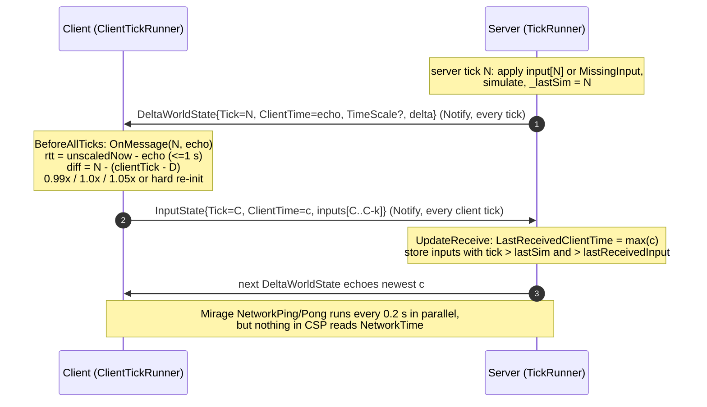

# CSP timing system deep-dive: `TickRunner`, `ClientTickRunner` and clock sync

Source reviewed: `James-Frowen/ClientSidePrediction` at `f8bc7b5` (package `1.0.0-beta.19`, depends on Mirage `157.0.0`; the Mirage checkout in this repo is `158.0.0`).
Method: read the code, plus a throw-away Python port of the timing logic to sanity-check dynamics (Appendix A). **Nothing was run in Unity.** Anything that comes from the port is labelled "model".

Citation convention: a bare `File.cs:123` is `clientsideprediction/Assets/source/Runtime/File.cs:123` (exceptions carry a sub-path, e.g. `Utils/MovingAverage.cs:40`, `Debugging/TickDebugger.cs:61`). Mirage paths are prefixed `Mirage:` and are relative to the Mirage repo root. The Mirage-side detail (report item 4) is in the companion file [`TickRunner-and-TimeSync-Mirage.md`](TickRunner-and-TimeSync-Mirage.md); section 4 below is the short version.

---

## 1. Summary

1. Timing is three separate things: (a) `TickRunner`, a Stopwatch-driven fixed-step accumulator with its own loop, pumped from `PredictionManager.Update` (not `FixedUpdate`) on server and client (`TickRunner.cs:160-228`, `PredictionManager.cs:326`); (b) `ClientTickRunner`, a feedback controller that makes the client's tick *numbers* equal the server's by running the client ahead (`TickRunner.cs:235-481`); (c) a third, independent clock for remote interpolation (`InterpolationTime`, `ClientInterpolation.cs:50-243`) that, as shipped, is never fed server time (section 2.7).
2. The server is the clock master. Its tick advances at wall rate (`TimeScaleMultiple` is always 1 on the server, `TickRunner.cs:70-73`). Every server tick it sends `DeltaWorldState{Tick, ClientTime, ...}` over Mirage **Notify** to every authenticated player (`StateSender.cs:69-91,152-153`), so ~50 messages/s per client.
3. Each client tick the client sends `InputState{Tick, ClientTime, inputs}` over Notify (`ClientManager.cs:463-473`). The server stores the newest `ClientTime` per player and echoes it back verbatim in every state message (`ServerInputHandler.cs:36`, `StateSender.cs:83`). The client turns that echo into an RTT sample (`TickRunner.cs:405-426`).
4. Client lead target: `D = (mean(RTT) + 2*stddev(RTT)) * tickRate + 1` ticks, capped at 60. The client wants `clientTick = latestReceivedServerTick + D`, i.e. its tick number *N* arrives at the server about `1 + 2*sigma*rate` ticks before the server simulates *N* (`TickRunner.cs:380-403`).
5. Drift correction is bang-bang on the **raw per-message** tick error: within +-1.5 ticks run at 1.0x; error above +1.5 run at 1.05x; below -1.5 run at 0.99x; beyond +-10 ticks hard-reset the tick, in either direction (`TickRunner.cs:357-374,438-455`). Only the RTT mean/stddev are smoothed (a 25-sample ring by default = 0.5 s at 50 Hz).
6. The server never tells the client how early or late its inputs were. It only logs lateness (`ServerInputHandler.cs:98-101`), drops late packets, and substitutes `MissingInput` (default: repeat the last valid input) for ticks with no input (`ServerController.cs:97-105`, `PredictionBehaviour.cs:84-93`). `PlayerTimeTracker` has a `todo` for metrics and nothing else (`PlayerTimeTracker.cs:16`).
7. Real defects found while reading (section 3.8): `MovingAverage` never counts its last slot (`Utils/MovingAverage.cs:37-40`); `lastFrame` is never initialised so the first client frame runs up to 6 ticks at once (`TickRunner.cs:76,162-166,316-321`); a stale echo (client stopped sending) is treated as a huge RTT sample and poisons the average; a hard skip *backwards* silences the client for the skip distance (`TickRunner.cs:192`). Model results: hitches of about 150 ms or more trigger hard skips or multi-second timescale drift, and 250 ms or more trigger multi-skip resync cascades (Appendix A).
8. Fact-check of the design note (section 5): of the seven checks (the five claims you listed, one of them split in two, plus the note's "authority over the clock" framing), **1 is true in effect (wrong cause)**, **1 is false/unsupported**, and **5 are partly true or partly false**. The "server forces a wall-clock timeline" framing and "RTT offset" wording are imprecise: the client shares tick numbering, not a clock offset, and no wall-clock offset is ever computed.
9. Mirage's `NetworkTime` is a 0.5 Hz ping/pong RTT + clock-offset estimator. CSP does not use it (it only sets `PingInterval` to 0.2 s, `PredictionManager.cs:177`, and nothing reads it). In a model of its estimator the offset is good to a few ms in steady state; what it lacks for CSP is per-packet jitter, hitch reaction and any tick mapping (companion file).
10. Opinion (section 6): `TickRunner` + `MovingAverage` are extractable as a standalone clock (the repo's own `TickDebugger` already drives them with two RPCs), but the controller should be fixed first. The self-clocking proposal removes the owner-side clock, but an FPS still needs a server-tick timeline for observers and lag compensation, and a server-side input-buffer depth is a better feedback signal than the RTT model.

---

## 2. Class by class

### 2.1 `PredictionTime` (`TickRunner.cs:17-35`)

Thin `IPredictionTime` facade over a `TickRunner`. `FixedTime = Tick * FixedDeltaTime`, `Time`/`DeltaTime`/`UnscaledTime` are forwarded from the runner. `Tick`, `IsResimulation`, `Method` are plain properties written by `ClientManager`/`ServerManager`, so `Tick` **rewinds during resimulation** while `TickRunner.Tick` does not (`ClientManager.cs:330-334`). Interface: `Interfaces.cs:24-74`.

### 2.2 `TickRunner` (`TickRunner.cs:36-233`)

Fixed-step accumulator driven by a `System.Diagnostics.Stopwatch` (`:75,:111,:155-158`).

| Member | Default | Meaning | Where |
|---|---|---|---|
| `TickRate` | 50 (field); `PredictionManager.TickRate` = 50 is pushed into both server and client runners | ticks per second; `FixedDeltaTime = 1/TickRate` | `:40,:120-124`; `PredictionManager.cs:48,117,186` |
| `MaxFrameTime` | 200 ms | stop starting new ticks once the frame has used this much wall time. Leftover `tickTimer` is **kept** for the next frame | `:55,:205-209` |
| `MaxTickPerFrame` | 5 | cap on catch-up. The check runs *after* each tick, so up to **6** ticks run (`_tick > startTick + 5`). On hit, `tickTimer = 0`, i.e. the remaining backlog is **dropped** | `:63,:211-219` |
| `TimeScaleMultiple` | 1 | client steering factor; "always 1 on server" | `:69-73` |
| `lastInvokedTick` | 0 | tick events fire only if `_tick > lastInvokedTick`. After a backward re-init, ticks are counted but **no events fire** until `_tick` passes the old high-water mark | `:83,:190-198` |
| events | `BeforeAllTicks`, `BeforeTick`/`OnTick`/`AfterTick`, `AfterAllTicks` | once-per-frame hooks around the per-tick hooks | `:89-107` |
| `SetRunning(bool)`, `IsRunning` | false until set | gate for the whole loop | `:114-118,:150` |
| `OnMessage(serverTick, clientTime)` | throws on the base class | placeholder so one field can hold either runner | `:232` |

`OnUpdate()` (`:160-228`), step by step:

1. `delta = now - lastFrame; lastFrame = now` (`:162-166,:172`). This is done even when not running, so un-pausing does not produce a huge delta (comment `:172-173`). The Editor-paused early return is *after* `lastFrame` is written for the same reason (`:168-171`).
2. If not running, return.
3. `timeDelta = delta * UnityEngine.Time.timeScale * TimeScaleMultiple; _time += timeDelta; tickTimer += timeDelta` (`:177-181`).
4. `BeforeAllTicks` (server: `Server.UpdateReceive`; client: `Client.UpdateReceive` + `InputUpdate`; `PredictionManager.cs:129,203-207`).
5. `while (tickTimer > FixedDeltaTime) { tickTimer -= dt; _tick++; if (_tick > lastInvokedTick) { BeforeTick; OnTick; AfterTick; lastInvokedTick = _tick } ... }` (`:185-221`) with the two exits above.
6. `AfterAllTicks` (server: `Server.UpdateSent`; client: `VisualUpdate` + `Client.UpdateSent`; `PredictionManager.cs:130,208-212`).

Callers: `PredictionManager.Update()` calls `_tickRunner?.OnUpdate()` every Unity frame (`PredictionManager.cs:314-333`). `ServerManager` subscribes `OnTick` (`ServerManager.cs:72`); `ClientManager` subscribes `OnTick`/`OnTickSkip` (`ClientManager.cs:96-97`).

### 2.3 `ClientTickRunner : TickRunner` (`TickRunner.cs:235-481`)

Constructor (`:275-306`), with the three different default sets in the repo:

| Parameter | Meaning | ctor default | `ClientTickSettings` default (what `PredictionManager` uses) | `TickDebugger` |
|---|---|---|---|---|
| `diffThreshold` | dead-band in **ticks**; `_positive = +x, _negative = -x` | 1.5 | 1.5 (`PredictionManager.cs:25`) | 1.5 |
| `timeScaleModifier` | `_fastScale = 1 + 5*m`, `_slowScale = 1 - m` (catch up 5x faster than slow down: "we never want to be behind", `:286-289`) | 0.01 (1.05x / 0.99x) | 0.01 | 0.01 |
| `skipThreshold` | hard re-init when `abs(diff)` exceeds this many ticks | 10 | 10 | 10 |
| `movingAverageCount` | RTT ring size (effective window is N-1, see 2.4) | 100 | **25** (`:28`) | 250 (`Debugging/TickDebugger.cs:61-63`) |

Constants: `MAX_RTT = 1.0 s` (clamps one RTT sample, `:241,:411-417`); `MAX_TICK_DELAY = 60` ticks (cap on lead; comment says it must stay below the 64-slot ring so resimulation fits, `:239-244`; `ClientManager.cs:302-306` refuses to resimulate more than `bufferSize`).

Public surface: `OnMessage(serverTick, clientSendTime)` (`:338`), `ResetTime()` (`:308`), `event OnTickSkip` (`:269`), `IsRunning => base.IsRunning && _initialized` (`:314`), `TimeScaleMultiple`, and under `#if DEBUG` `Debug_DelayInTicks`, `Debug_RTT` (`:257-260`). `OnUpdate()` only calls the base loop once `_initialized` (`:316-321`).

Callers: `ClientManager.ReceiveDeltaWorldState` -> `OnMessage` (`ClientManager.cs:188`); `PredictionManager.ClientStarted` constructs it (`:179-190`); `SetClientReady(true)` calls `ResetTime()` (`:256-259`).

Lineage: the doc comment on `OnMessage` (`TickRunner.cs:334-337`) is a copy of `InterpolationTime.OnMessage` (`ClientInterpolation.cs:160-163`), and the threshold/scale/skip structure is the same. `ClientTickRunner` is that class re-targeted from a seconds-based EMA of the diff to a tick-based controller fed by an RTT window.

### 2.4 `MovingAverage` (`Utils/MovingAverage.cs`, 92 lines)

A float ring buffer with `Add`, `GetAverage`, `GetStandardDeviation` (sample, n-1), `GetAverageAndStandardDeviation`, `Reset` (`:33-90`). Recomputes sums on every query (O(N)); fine for N=25.

**Off-by-one:** `Add` wraps `_index` to 0 *before* updating `_countInBuffer = Math.Max(_index, _countInBuffer)` (`:35-40`). Once the ring fills, `_index` is 0 at that moment, so the count stays at `size - 1` forever. Slot `size-1` is written but never read: one sample in every N is silently ignored, and the effective window is N-1 (24 for the default). The tests never exceed the buffer: max 5 adds into a size-10 ring (`Assets/Tests/SimpleMovingAverageTest.cs:11-77`). Practical impact is small (a 1/N sample loss), but a spike that lands on that slot is invisible.

Not to be confused with Mirage's `ExponentialMovingAverage` (`Mirage:Assets/Mirage/Runtime/ExponentialMovingAverage.cs`), which `InterpolationTime` and `TickDebugger` use.

### 2.5 `PlayerTimeTracker`, `ITickNotifyTracker`, `TickNotifyToken`

- `PlayerTimeTracker` (server, one per player, `PlayerTimeTracker.cs:14-35`): `LastReceivedClientTime` (double), `lastReceivedInput` (int?), `ReadyForWorldState`, `LastAckedTick` (state tick the client acked). The comment `// todo use this to collect metrics about client (eg ping, rtt, etc)` (`:16`) is the only "per-player measurement" intent; nothing is measured.
- `ITickNotifyTracker` + `TickNotifyToken : INotifyCallBack` (`ITickNotifyTracker.cs:15-52`): a pooled Notify callback that, on `OnDelivered`, calls `tracker.SetLastAcked(tick)` (max). `OnLost` just returns the token to the pool. Used for **two** acks, neither of which is a clock: server-to-client state acks pick the delta-compression baseline (`StateSender.cs:152-153,227-250`); client-to-server input acks decide how many past inputs to repeat (`ClientManager.cs:51-65,432-440`).

### 2.6 Time-related message fields (`Messages.cs`)

| Message | Field | Role |
|---|---|---|
| `DeltaWorldState` (`:16-38`) | `Tick` (`:19`) | server tick this state is the result of |
| | `ClientTime` (`:30`, double, 8 bytes) | newest client send-time the server has seen, echoed for RTT |
| | `TimeScale` (`:24`, `float?`) | server `Time.timeScale`, null if 1; the client sets its own `Time.timeScale` to it (`ClientManager.cs:170-178`) |
| | `VsTick` (`:20`) | delta baseline, not timing |
| `InputState` (`:49-66`) | `Tick` (`:52`) | client tick of the newest input in the packet |
| | `ClientTime` (`:53`) | client Stopwatch time at send |
| | `Ready` (`:54`), `NumberOfInputs` 1-8 (`:59-60`) | readiness and redundancy |

`ClientTime` is *only* ever consumed by the echo path; grep shows no other server-side use (`ServerInputHandler.cs:36`, `StateSender.cs:83`).

### 2.7 The interpolation clock (`ClientInterpolation.cs`) - appears unwired

`ClientManager` creates a `ClientInterpolation` (`ClientManager.cs:99`) that owns an `InterpolationTime` (`ClientInterpolation.cs:492`): 2-tick delay, 0.5-tick threshold, +-1% scale, 2.5-tick skip, EMA(30) (`:134-149`). Snapshots are stamped `tick * FixedDeltaTime` on every state message (`:495-504`) and sampled at `_timeSync.Time = clientTime - delay` (`:518`).

Finding: **`InterpolationTime.OnMessage(serverTime)` has no caller** in the repo (`grep _timeSync|InterpolationTime` shows only construction, `OnUpdate`, `Time`, `ClientDelay`). So `_clientTime` free-runs from 0 at the first running frame (advanced by `_time.DeltaTime`, which already includes `TimeScaleMultiple`, `:508`) and is never aligned to server tick time. It can only line up by coincidence, for example when server and client are started together in one test scene with the tick counter starting near 0; otherwise `First.time > now` and the lookup returns the earliest snapshot while `RemoveOldSnapshots` never trims (`:324-334,:382-393`). No example calls `ClientInterpolation.GetState` (`:531`). I could not tell whether this is unfinished or relies on external code. Either way: **CSP has no working shared-server-timeline estimate for observers out of the box.**

### 2.8 Debug and tests

- `Debugging/TickDebugger.cs` (91 lines): a Mirage `NetworkBehaviour` that runs a `TickRunner` on the server and a `ClientTickRunner` on the client using only two unreliable RPCs: `ToServer_InputMessage(tick, unscaledTime)` and `ToClient_StateMessage(tick, clientTime)` (`:74-90`). It proves the clock works **without any other CSP code**. It sets `NetworkTime.PingInterval = 0` (`:65`), which in Mirage means "ping every frame", not "off".
- `TickDebuggerGui` shows client tick, server tick, diff, timescale, RTT, jitter, and "Target Delay" (`Debugging/TickDebuggerGui.cs:7-38`). On the server, `ClientTick - ServerTick` is shown as Ahead/behind: the only place the server's view of "how far ahead is the client" exists (`PredictionManager.cs:343-347`).
- `Debugging/LagSocket/LagSocketFactory.cs`: a socket wrapper simulating latency, sinusoidal latency/jitter, zag and drop (`:40-72`). Use this for validating any timing work.
- Unit tests cover `MovingAverage` only. No test for `TickRunner` or `ClientTickRunner`.

---

## 3. The algorithm

### 3.1 How the server tick advances

Own loop, not `FixedUpdate`: `PredictionManager.Update` -> `TickRunner.OnUpdate` (`PredictionManager.cs:326`). Wall time comes from a Stopwatch, scaled by `Time.timeScale` (the server's own value, which is replicated to clients, `StateSender.cs:81`).

Per server tick (`ServerManager.Tick`, `ServerManager.cs:138-151`): copy previous snapshot, `Simulate(tick)` (apply that object's input for `tick` via `ServerController.Tick`, `NetworkFixedUpdate`, `IPredictionSimulation.Simulate`), `_lastSim = tick`, `_sender.SendState(tick)`. `_lastSim` is what `ServerInputHandler` compares arriving inputs against (`ServerManager.cs:91-94`).

Receive/send are tied to the loop: `BeforeAllTicks += Server.UpdateReceive`, `AfterAllTicks += Server.UpdateSent` (`PredictionManager.cs:129-130`). So inputs are read **once per frame**, before that frame's ticks. Note `Server.ManualUpdate = false` (`:93`) and is never set true for a server-only instance, so Mirage's own `NetworkServer.Update` also pumps receive/send each Unity frame (`Mirage:Assets/Mirage/Runtime/NetworkServer.cs:401-407`). Harmless, but receive timing is therefore not strictly tied to the tick loop. Notify packets are written to the socket immediately when sent, not at `UpdateSent` (`Mirage:Assets/Mirage/Runtime/SocketLayer/Connection/AckSystem.cs:314-340`), so state messages leave during the tick.

Server catch-up is bounded **and lossy**: at most 6 ticks per frame, then `tickTimer = 0` (`TickRunner.cs:211-219`). A server hitch longer than ~120 ms permanently loses wall time: server tick falls behind real time.

### 3.2 Messages and the sync exchange



| Message | Dir | Channel | Rate | Evidence |
|---|---|---|---|---|
| `InputState` | C -> S | Notify (`_clientPlayer.Send(message, token)`) | every client tick, always (even with no owned objects: the payload is just empty) | `ClientManager.cs:463-473` |
| `DeltaWorldState` | S -> C | Notify; **Reliable fragmented** if the delta payload exceeds `1219 - 26` bytes | every server tick, to every authenticated player, even before the client is ready (`SendNoPayload` still carries `Tick`/`ClientTime`) | `StateSender.cs:28,69-91,135-170,256-261` |
| `DeltaWorldStateFragmentedAck` | C -> S | Reliable | one per fragmented state | `ClientManager.cs:159-162`, `StateSender.cs:171-175` |

`1219` is `UdpMTU.MaxPacketSize (1280-48=1232) - NOTIFY_HEADER_SIZE (13)` (`Mirage:Assets/Mirage/Runtime/Sockets/Udp/UdpSocketFactory.cs:225-239`, `AckSystem.cs:12-15`). A reliable-path state can arrive after a later Notify state and then be dropped by `lastReceivedTick > msg.Tick` (`ClientManager.cs:164-168`); I did not see special handling.

### 3.3 How the client estimates its lead

**RTT sample** (per state message, `TickRunner.cs:405-426`): `rho = UnscaledTime - echo`, where `UnscaledTime` is the client's Stopwatch at the moment the message is *handled* (frame start), `echo` is the Stopwatch value at which the client sent the newest input the server had received when it sent the state. Clamp `rho <= 1.0 s`. If `echo == 0` (server has not yet received any input) push a placeholder `0.150 s`.

**Window statistics:** `mu`, `sigma` = mean and sample stddev over the ring (`Utils/MovingAverage.cs:43-84`).

**Lead target in ticks** (`DelayInTicks`, `TickRunner.cs:380-403`):

    D = min( (mu + 2*sigma) * TickRate + 1 , 60 )

**Controller error** (`OnMessage`, `:357-360`):

    serverGuess = clientTick - D
    diff        = serverTick - serverGuess = serverTick - clientTick + D

`diff = 0` means `clientTick = serverTick + D`: the client is `D` ticks ahead of the **latest received** state.

**Why that is the right lead.** A state for tick `S` arrives one downlink delay `d2` after it was produced, when the server is already at about `S + d2*r`. An input sent now reaches the server after `d1`, when the server is at about `S + (d1+d2)*r = S + RTT*r`. The client must have *numbered* that input at least `RTT*r` ahead of `S`, so that it lands before the server simulates that tick. The `+2*sigma*r + 1` is the safety margin: roughly 2 sigma of RTT jitter plus one tick for tick quantisation and for the redundancy re-send (the next packet carries the previous inputs, `ClientManager.cs:438-461`). The full RTT, not half, is correct because the reference point is the *received* server tick, not the server's current tick.

**Biases in the sample** (my analysis, consistent with the model): `rho` measures the application-level loop, not transport RTT. It includes the wait for the server's next frame start to read the input (0..1 frame), the gap before the server tick that sends the state (the echo is not corrected for server hold time), and the wait for the client's next frame start (0..1 frame). With 60 fps on both ends this adds on the order of 10-25 ms, so D errs on the long side by roughly 0.5-1 tick and sigma is inflated by frame quantisation. In the model (RTT about 90 ms on the wire) the target was D about 7.5 ticks and inputs reached the server a median of 5 ticks (100 ms) early, with 0 late inputs in 2,900 and also at 5% and 15% packet loss (Appendix A).

### 3.4 How the client corrects drift

| Condition on `diff` (ticks) | Action | Code |
|---|---|---|
| `abs(diff) > 10` | `InitNew`: `_tick = ceil(serverTick + D)`, scale 1.0, fire `OnTickSkip` (ClientManager clears `ackedInput`). Works forward **and backward** | `TickRunner.cs:365-371,428-436`, `ClientManager.cs:121-128` |
| `diff > +1.5` (client behind) | `TimeScaleMultiple = 1.05` | `:447-448` |
| `diff < -1.5` (client ahead) | `TimeScaleMultiple = 0.99` | `:450-451` |
| otherwise | 1.0 | `:453-454` |

Properties worth knowing:

- Evaluated on **every state message** on the *instantaneous* `diff` (no smoothing of `diff`, no hysteresis). The only smoothing is inside D via the RTT window.
- Asymmetric rates: +5% / -1%. Being 5 ticks (100 ms) too far ahead takes about 10 s to bleed off; being 5 ticks behind takes 2 s to catch up.
- `TimeScaleMultiple` scales the runner's `DeltaTime`, so everything driven from `PredictionTime.DeltaTime` (e.g. the interpolation clock, `ClientInterpolation.cs:508`) speeds up and slows down with it.
- `InitNew` does not clear the RTT window.
- A backward re-init stalls the client (section 3.6) because ticks at or below `lastInvokedTick` do not fire events (`TickRunner.cs:192`).

### 3.5 What the server measures per player

- On every `InputState` (before any validation) `LastReceivedClientTime = max(LastReceivedClientTime, ClientTime)` (`ServerInputHandler.cs:36`). This is the echo source. Late or out-of-order packets still advance it.
- `ValidateInputTick` (`:81-105`): reject if the packet is older than `lastReceivedInput` (out of order, `:85-89`); accept if `tick >= lastSimTick` (`:92`); otherwise it is late: log (with "late by N" ticks) and drop the whole packet (`:98-104`). Because the check is before `tracker.ReadyForWorldState = message.Ready` (`:41`), a late packet also cannot change readiness.
- Per-input acceptance: `inputTick > tracker.lastReceivedInput && inputTick > lastSimulation` (`ServerController.cs:51`). The redundant older inputs in a packet are therefore used only if they fill a gap that is still in the future. Note `lastReceivedInput` is `int?`: while it is null the lifted `>` is false, so the very first packet's inputs appear to be skipped (one-time, minor; not tested).
- Missing input at tick `t`: `behaviour.MissingInput(lastValidInput.input, lastValidInput.tick, t)`, default returns the previous input (`ServerController.cs:97-105`, `PredictionBehaviour.cs:84-93`). Before the first packet is accepted the server applies a default (zero) input and does not call `MissingInput` (`ServerController.cs:86-87`).
- **Feedback to the client: none.** `DeltaWorldState` carries no earliness/lateness/buffer-depth field (`Messages.cs:16-38`). The client infers it indirectly through RTT. The server *could* cheaply report `tick - lastSimTick` at `ServerInputHandler.cs:92-96`; it does not.

### 3.6 Edge cases

"Model" = Python port of the controller, Appendix A (60 fps both ends, wire RTT about 90 ms, U[0,10] ms jitter per direction, zero CPU time). Treat magnitudes as indicative only; the mechanisms come from the cited code.

| Situation | What the code does | Consequence | Model |
|---|---|---|---|
| **Startup / first sync** | Runner is built at `Client.Started`, before the connection exists (`PredictionManager.cs:179-190`; `Mirage:Assets/Mirage/Runtime/NetworkClient.cs:172-174`). Until the first state message `IsRunning` is false and `Update` pumps Mirage by hand (`PredictionManager.cs:317-324`). First message pushes the 150 ms placeholder, `InitNew` -> `_tick = ceil(serverTick + 8.5) = serverTick + 9` (`TickRunner.cs:340-354,428-436`). Same frame: `lastFrame` was never set (it is only written inside the base `OnUpdate`, which the subclass skips while uninitialised, `:316-321`), so `delta = elapsed since runner construction`. That is capped to 6 ticks and `tickTimer = 0` (`:211-219`) | Client starts about 6 ticks further ahead than intended. Placeholders (one per state message until the first echo arrives, about 1 RTT) plus the 24-sample window keep D inflated for about 0.5 s | Lead started at about 14 ticks vs a target of 8; scale stayed 0.99 for about 10-12 s before returning to the dead-band |
| **Packet loss** | State loss: no special handling, the next state still gives a sample; delta baseline is the last *acked* tick so gaps do not break decoding (`StateSender.cs:227-250`). Input loss: `OnLost` is a no-op; the next packet repeats unacked inputs (up to 8, `ClientManager.cs:438-461`); an input that is still missing when the server reaches its tick is replaced by `MissingInput` | Redundancy only works because the lead margin exists: the next packet arrives about 1 tick later and still beats the server | 5% and 15% loss: lead 8.2-8.4, 0 late inputs |
| **Latency spike** | One large RTT sample raises mean and stddev (stddev of a 25-sample window with one outlier is large: 160 ms outlier gives sigma about 30 ms, so D rises about 3.5 ticks) for the window length, then D falls back and the client is left ahead, bled off at 1%/s | Visible as 1.05x for about a second, then slow 0.99x for seconds | +150 ms on packets sent in a 100 ms window: no skip, D peak 11.2, 2 late inputs, about 3 s to settle |
| **Client hitch** (frame freeze) | `delta` is huge, 6 ticks run, rest of backlog is dropped (`:211-219`); the client sent nothing for the freeze, so the server's `LastReceivedClientTime` is frozen and every state it sends carries the **stale echo**. On resume Mirage drains all queued states in one `UpdateReceive` and each yields `rho = now - staleEcho` (about the hitch length, clamped to 1 s) (`:411-419`) | RTT average is poisoned, D jumps (to the 60 cap for hitches of 1 s), `abs(diff) > 10` fires repeatedly, the client hard-skips forward, later D recovers and it skips **backward**, which silences the client for the skip distance | 250 ms: 3 skips (2 fwd, 1 back, 0.25 s pause), D peak 21; 500 ms: 8 skips (5 fwd, 3 back, 0.62 s of pauses), D peak 40, about 10 s to settle; 1 s: 15 skips. Server ticks with no input: 15 (250 ms hitch), 45 (500 ms) |
| **Server hitch** | Server runs 6 ticks, drops the rest of the backlog (`:211-219`), so server tick lags wall time by `(hitch - ~120 ms)`. Client keeps ticking in real time, so `diff` goes negative by that many ticks | 150-250 ms: no skip, `diff` -2..-8, 0.99x for 6-19 s. About 300 ms or more: `diff < -10` -> backward re-init -> the client **stalls for the skip distance** (no inputs sent, no local simulation), the stale-echo effect above then inflates RTT too | 400 ms: 3 skips, 0.55 s paused, D peak 22; 1 s: 7 skips. 100 ms: no effect |
| **Tab-out / background** | No focus or pause handling anywhere (grep `OnApplicationFocus`/`OnApplicationPause`/`runInBackground` finds nothing in CSP). Mirage sets `Application.runInBackground = true` on client and server start (`Mirage:Assets/Mirage/Runtime/NetworkClient.cs:52,160-161`), so desktop builds keep ticking. Where Update is throttled (WebGL hidden tab, mobile) it is a client hitch as above | Same as client hitch | - |
| **Editor pause** | `EditorApplication.isPaused` returns early after `lastFrame` is updated (`:168-172`) | clean | - |
| **Server stopped** (`SetServerRunning(false)`) | No ticks, so no `SendState` (`PredictionManager.cs:266-273`). Clients just stop receiving; nothing detects it until messages resume | on resume `diff` is large and negative (client kept ticking) | - |

### 3.7 Timelines

Numeric example: wire RTT 100 ms (50 ms each way), tick 20 ms, `sigma` of RTT 5 ms. `D = (0.100 + 0.010) * 50 + 1 = 6.5` ticks.

```
wall time ------------------------------------------------------------>

server current tick (now)               S
latest state the client holds           S - 2.5   (50 ms downlink = 2.5 ticks)
client predicted tick  C = (S-2.5)+D    S + 4.0   (local player simulates here)
   input for C reaches server when the server is at  S + 2.5
   => 1.5 ticks early = 1 + 2*sigma*rate
remote interpolation (intended, if the
 clock were fed): latest received - 2   S - 4.5
```

| Timeline | Tick | Who uses it | Source of the number |
|---|---|---|---|
| Server tick | `S` | simulation, state labels | `TickRunner` on the server |
| Latest received server tick | `S - RTT/2*r` | reconcile baseline (`lastReceivedTick`), controller reference | `ClientManager.cs:215` |
| Client predicted tick | latest received `+ D` | local simulation, input labels, state history index | `ClientTickRunner` |
| Resimulation window | `lastReceivedTick+1 .. clientTick-1` (about `D` ticks, max 64) | corrections | `ClientManager.cs:388-394,302-306` |
| Remote interpolation tick | intended `latest - 2`; as shipped free-running | observers | `ClientInterpolation.cs:518` (unwired, section 2.7) |

Because client tick `N` and server tick `N` are the same number for the same simulation step, a received state is compared directly with the client's predicted state at slot `N % 64` (`ClientManager.cs:244-245,258`) and no per-message tick translation happens anywhere.

### 3.8 Defects and oddities found (not all matter equally)

1. `MovingAverage` never counts the last ring slot (`Utils/MovingAverage.cs:37-40`).
2. `lastFrame` uninitialised for the client until the first initialised frame, first-frame burst of up to 6 ticks (`TickRunner.cs:76,162-166,316-321`). Also hits after `ResetTime()` (`SetClientReady(true)`).
3. Stale-echo poisoning: `rho = now - echo` is added even when the echo has not advanced (`TickRunner.cs:411-419`). Any gap in client sends (hitch, backward-skip stall) becomes a large RTT sample, repeated once per queued state.
4. Backward re-init stalls the client: `InitNew` can lower `_tick`, and `_tick > lastInvokedTick` (`:192`) suppresses `OnTick`, so no input is sent for the skip distance. The author's own `todo` flags this (`:364`).
5. `Math.Abs(diff) > skip` logs "Client fell behind" even when the client is ahead (`:365-369`).
6. `MaxTickPerFrame = 5` runs 6 ticks; the drop-the-backlog branch (`tickTimer = 0`) is documented in a `todo` as possibly harmful in multiplayer (`:215-218`).
7. Echoed `ClientTime` is not corrected for server hold time, so RTT is overestimated by up to a frame plus tick phase.
8. Unwired `InterpolationTime.OnMessage` (section 2.7).
9. `PredictionManager.PingInterval` ("used to make sure inputs are delay by correct amount", `:49-50`) only configures Mirage's ping, whose result CSP never reads. The tooltip is stale; the pings cost about 5 pings+pongs/s per client for no consumer.
10. No tick-rate handshake: both sides read their own `PredictionManager.TickRate` (`:48`); a mismatch is silent.
11. `SendNotReadyInputs` looks unreachable via the public API, since `SetClientReady` flips `ReadyForWorldState` and `SetRunning` together (`PredictionManager.cs:249-254`) and ticks only run when running. The server therefore learns readiness from the first `Ready=true` packet and never un-readies a client.
12. Ring buffers are tick-indexed without a stored tick (`Utils/RingBuffer.cs:36-53`), so a never-written client input slot can return a value from 64 ticks earlier; after a forward skip, resimulation reads inputs for ticks the client never produced (`ClientController.cs:78-79`, `Utils/NullableRingBuffer.cs:34-42`).

---

## 4. Mirage's built-in time sync (short version; full detail in the companion file)

- `NetworkTime` (`Mirage:Assets/Mirage/Runtime/NetworkTime.cs`) is owned by `NetworkWorld.Time` (`NetworkWorld.cs:49`). The client sends `NetworkPingMessage{ClientTime}` on `Channel.Unreliable` every `PingInterval` (default **2 s**, `:19`, driven from `NetworkClient.Update`, `NetworkClient.cs:359-366`) and once on connect (`:193`). The server replies `NetworkPongMessage{ClientTime, ServerTime}` (`:82-93`).
- Per pong the client updates `Rtt` (EMA, window 10) and `Offset` (EMA, window 10) with `offset = now - rtt/2 - serverTime`, intersected with a never-aging `[min,max]` bracket (`:98-127`). `Time = LocalTime - Offset` is cached per frame (`:158-175`).
- It measures application-level RTT (frame waits included, as the Mirage doc says, `doc/docs/guides/clock-sync.md`). In a model of the estimator the offset is good to about 1-4 ms in steady state plus half the path asymmetry (+15 ms for a 60/30 ms uplink/downlink split); the RTT EMA read about 108 ms for a 90 ms wire RTT.
- Why it is not the CSP controller: 0.5 Hz sample rate and a 10-sample EMA (20 s) cannot see per-packet jitter, loss bursts or hitches; it gives a number, not a tick schedule; it is not tied to the server's tick counter (which can drop time, section 3.1). It could be a reasonable *seed* for a tick estimate and for the UI ping.
- SocketLayer exposes **no RTT**. It does expose per-packet Notify delivered/lost callbacks that CSP already uses (`TickNotifyToken`), which could carry a send timestamp to get ack-based RTT with no stale-echo problem.

---

## 5. Fact-check of the design note

Source: `Plans/SimpleCSP/inputs/TimingSystem_ApproachA_vs_Legacy.md` (identical to the uploaded copy).

| # | Claim about the legacy system | Verdict | Evidence |
|---|---|---|---|
| 1 | "Echoes server tick; requires client to estimate RTT offset." | **Partly true (imprecise)** | True that the state echoes the server tick (`Messages.cs:19`, `StateSender.cs:80`). The client does estimate RTT and jitter, but to pick *how far ahead to run* (`TickRunner.cs:380-403`), not to translate echoed ticks: after sync, client tick N *is* server tick N and states are applied by direct index (`ClientManager.cs:217-245`). No clock offset is ever computed in CSP (no server-time value is exchanged; `ClientTime` is the client's own Stopwatch echoed back). The note's section 1 sentence "the client would have to constantly measure RTT and jitter to translate server ticks to local buffer slots" is wrong for the legacy code; the measurement is needed to keep the lead, not to translate. |
| 2a | "Clock sync prevents inflation." | **True in effect, wrong cause** | A client running at 100 Hz cannot make the server step more: the server consumes exactly one input per server tick, looked up by tick (`ServerController.cs:58-95`) and the server tick advances at wall rate (`TickRunner.cs:70-73,177-181`). That is a property of the server-owned tick, not of the sync layer. There is no upper bound on how far ahead input ticks may be (`ServerInputHandler.cs:92` accepts any `tick >= lastSim`), only the 64-slot wrap (`ServerController.cs:44,54`). |
| 2b | "...but sync layer itself is vulnerable to jitter spoofing." | **False / unsupported** | The estimator runs entirely on the client (`TickRunner.cs:245,405-426`). The server only echoes `max(ClientTime)` and never uses it for anything (`ServerInputHandler.cs:36`, `StateSender.cs:83`). A client that spoofs RTT/jitter only changes its own lead: inputs arrive late and are replaced by `MissingInput`, or arrive early and wait. There is no server-side decision that depends on the spoofed value. (Real weakness is different: the echo is unvalidated and the server does no arrival-time analysis at all, `PlayerTimeTracker.cs:16`.) |
| 3 | "Client hitch: server extrapolates fake inputs, causing severe rubber-banding on resume." | **Partly true** | Mechanism exists: for ticks with no input the server calls `MissingInput`, default = repeat the last valid input (`ServerController.cs:97-105`, `PredictionBehaviour.cs:84-93`), and keeps simulating the player. "Fake" is overstated (it repeats the last real input and is a `virtual` hook). Magnitude is speed x gap: model gave 15 server ticks without usable input for a 250 ms freeze and 45 for 500 ms. The note misses the client-side half of the problem: after the freeze the controller hard-skips and may skip back and stall (section 3.6), and resimulation reads inputs for ticks never produced (defect 12). "Severe" is plausible but unmeasured; `ResimulationTransition` can smooth the visual (`PredictionBehaviour.cs:153-160`). |
| 4 | "Server hitch distorts client RTT averages and triggers timescale drift." | **Partly true** | Drift: true. A server hitch over about 120 ms drops backlog (`TickRunner.cs:211-219`), so `diff` goes negative; 150-250 ms gives 0.99x for 6-19 s, larger gives a backward skip (model). RTT distortion: **not directly**. After a pure server hitch the echo is the newest input drained, so samples stay normal (model: D flat at 8 for 150/250 ms hitches). It becomes true *indirectly*: the backward skip stalls the client, the echo goes stale, and RTT samples grow to 0.4 s (model: D peak 22 for a 400 ms server hitch). |
| 5 | "~400+ lines across `TickRunner`, `MovingAverage` and controllers." | **Partly true / overstated** | Raw file lines: `TickRunner.cs` 482 + `MovingAverage.cs` 92 = 574. Code lines (excluding blanks, comments, braces, the `#if CLIENT_TICK_RUNNER_VERBOSE` debug blocks): `TickRunner` 78 + `ClientTickRunner` 91 + `PredictionTime` 12 + `MovingAverage` 40 = about 220, plus about 10 lines of wiring (echo field, `ClientTime` writes/reads). `ClientController`/`ServerController` (49 and 53 code lines) contain no clock logic. |
| 6 | Section 1 framing: legacy gives "authority over the clock ... the server forces everyone onto a single wall-clock timeline." | **Partly false** | The server owns a *tick counter*, not a wall-clock epoch: it is an accumulator that drops backlog under load (`TickRunner.cs:211-219`), no epoch or offset is shared, and clients each pick their own lead. What is shared is tick numbering. |

Not checkable against the legacy code (Approach A claims, listed for completeness): "~30 lines of validation logic", "catches up via bounded loop <= 5 inputs/frame in ~200 ms", "zero client clock offset needed". Context for the second: the legacy server's own catch-up is also bounded (6 ticks/frame) but **drops** the remainder rather than catching up, which is the real contrast. The third holds for owner reconciliation only (section 6.4).

---

## 6. Assessment for a per-object SimpleCSP (opinion)

Everything in this section is my judgement, not a finding.

### 6.1 Can `TickRunner` be used as a standalone clock?

Yes for the base class; mostly yes for the client controller.

- **Dependencies of `TickRunner.cs`:** `System.Diagnostics.Stopwatch`; `UnityEngine.Time.timeScale` and `Mathf.CeilToInt`; `Mirage.Logging` (only for `LogFactory.GetLogger`, replaceable); `UnityEngine.Assertions`; `UnityEditor.EditorApplication.isPaused` under `UNITY_EDITOR`; `PredictionTime` pulls in `IPredictionTime`/`UpdateMethod` from `Interfaces.cs`, which can be dropped. `ClientTickRunner` additionally needs only `MovingAverage` (no dependencies of its own).
- **Evidence it stands alone:** `Debugging/TickDebugger.cs` drives a `TickRunner` on the server and a `ClientTickRunner` on the client with two unreliable RPCs and nothing else (`:47-90`).
- **What it needs from the transport:** a `{tick, time}` message each way at tick rate, and the server echoing the newest client time per connection. With self-clocking and no server master clock, there is nothing for `ClientTickRunner` to follow, so that class does not apply as-is.

### 6.2 Minimal version if a server-master timeline is kept

Keep: Stopwatch accumulator, events, `FixedDeltaTime`, `MaxTickPerFrame` (but decide catch-up vs drop explicitly), per-connection echo, the lead formula, the dead-band + 1.05/0.99 scales.

Change before relying on it (each is small):
1. Initialise `lastFrame` on first update and on `ResetTime()`.
2. Fix `MovingAverage.Add` (increment the count before wrapping, or `min(count+1, size)`).
3. Do not add an RTT sample when the echoed client time has not advanced (stale echo); or take RTT from Notify acks. Model: a one-line stale-echo guard cut the 400 ms server-hitch case from 3 skips / D peak 22 to 1 skip / D peak 7.6, and the 250 ms client-hitch case from 3 skips to 1 (Appendix A). It does not remove the backward-skip stall.
4. Make "too far ahead" a slow-down or a bounded pause that still sends inputs, not an event-silencing backward re-init. Or only ever skip forward and absorb surplus by 0.99x.
5. Smooth `diff` (EMA) and add hysteresis so single messages do not toggle 1.05x/0.99x.
6. Add a tick-rate field to the connect handshake.
7. Prefer server-measured feedback to the RTT model: the server already knows exactly how early each input is (`tick - lastSimTick`, `ServerInputHandler.cs:92-96`). Echo that (a byte or two per state) and have the client steer to a target depth of 1-2 ticks. That signal is immune to stale echoes, frame quantisation and RTT asymmetry, and it is what the design review's option (c) proposes.

### 6.3 Trade-offs against "client numbers its ticks, server follows"

| Concern | Legacy (server tick master, client leads) | Self-clocking (client labels, server follows) |
|---|---|---|
| Owner reconcile | needs aligned numbering, hence the controller | needs none: echo `lastAppliedInputTick` |
| Server step cadence per player | exactly one input per server tick if the lead is right; regular for observers | follows arrival jitter and bursts unless a small server-side input buffer is added |
| Hitch behaviour | cascade of resyncs (section 3.6) | explicit pause/catch-up/token-bucket policy (new code, but easier to reason about) |
| Rate cheating | a client cannot make the server step faster (server consumes one input per server tick) | needs the token bucket |
| Lag switch | late inputs are dropped and gaps are filled by `MissingInput`, so no time can be banked | needs a max-lag bound (design review 3.3) |
| Observers | server-tick snapshots; interpolation clock exists but is unwired | must stamp snapshots with a server tick anyway |
| Lag compensation | server tick history exists implicitly; view tick still must be reported | same, plus a mapping owner-tick to server tick is lost |
| Code | about 220 logic lines + fixes | about 30 lines for the owner stream, plus an observer clock that both designs need |

### 6.4 What remote objects and lag compensation need from a shared timeline

The self-clocking approach removes the *owner's* need for server time. These things still need a server timeline and do not come for free:

1. **Server-tick-indexed history of every lag-compensated entity.** Hitscan rewind needs `position(player, serverTick)` for all players. That is a server concept independent of owners' input numbering: snapshot every server tick regardless of which input each player's stream had reached. Self-clocking with burst catch-up (up to 5 inputs per frame) makes that history jerky unless a small per-player buffer smooths consumption.
2. **A trailing observer clock in server ticks.** Observers (and the shooter, for what it sees) interpolate at about `latestReceivedServerTick - 2` with a gentle +-1% scale. This is receive-driven: no RTT, no "ahead of the server". It is what `InterpolationTime` was meant to do and is not wired in the legacy code.
3. **View-tick reporting.** Each input needs to carry the server tick (plus fraction) the shooter was rendering. The server needs "now" in its own ticks to clamp `serverNow - viewTick` to a maximum rewind. Both are cheap if every observer-bound state is stamped with the server tick; neither requires clock offset estimation.
4. **A mapping owner tick to server tick** (the lead). The legacy design gets identity by construction. Self-clocking loses it: you cannot answer "at what server tick did the owner's input *n* take effect?" except by recording `serverTick` when each input is consumed. Needed for fire-rate validation in server time, for predicting against moving world objects (platforms, doors), and for debugging.
5. **Bounding stream lag behind server time** (anti lag-switch), which is a server-timeline concept again.
6. **Uniform spacing of the owner's authoritative states** as seen by others. Self-clocking is fine for the owner's own reconcile, but observers and lag comp see the server-side motion, so network jitter would show up as uneven movement unless the server keeps a 1-2 tick buffer per stream.

Net recommendation (opinion): treat the clock as two orthogonal pieces. (a) *Owner path*: self-clocked tick stream plus a server-side input buffer whose depth is reported back and used to nudge the client tick rate (this replaces the RTT controller and its failure modes). (b) *Observer/lag-comp path*: stamp every outgoing snapshot with the server's own tick, run a receive-driven interpolation clock in server ticks, and have inputs carry the rendered server tick. Reuse from legacy: `TickRunner` as the server's Stopwatch accumulator (with an explicit catch-up policy) and the `InterpolationTime` idea, wired up. Do not carry over the RTT-window controller.

---

## Appendix A. Model used for the numbers

A Python port of `TickRunner.OnUpdate`, `ClientTickRunner.OnMessage/DelayInTicks/InitNew/AdjustClientTimeScale`, and `MovingAverage` (including the count quirk), plus a toy server (6-tick cap, drops backlog, echoes newest client time, sends one state per tick) and a UDP-like link. Parameters unless stated: tick 50 Hz, frames 60 fps both ends with +-0.5 ms jitter, one-way delay 40 ms + U[0,10] ms, window 25, runner built at t=0 and first state arriving at about 0.3 s, zero CPU time, Notify packets leave immediately, redundancy and acks modelled only enough to feed the input counts. This is **not** the Unity runtime; frame timing, Mirage receive timing and processing time differ. The port was not saved in the repo (throw-away).

Steady state (60 s): D target 7.4-7.6 ticks, lead over latest received state 8.0, inputs 4-5 ticks early at the server, 0 late in 2,900; with 5% / 15% loss also 0 late.

Client hitch (at t=30, otherwise steady):

| Hitch | Skips | Peak D (ticks) | Pause after (client not ticking) | Settle (approx) |
|---|---|---|---|---|
| 50 ms | 0 | 8.1 | none | about 3 s |
| 100 ms | 0 | 10.5 | none | about 2 s |
| 150 ms | 1 | 14.2 | none | about 14 s |
| 250 ms | 3 | 21.5 | 0.25 s | about 12 s |
| 500 ms | 8 | 40.4 | 0.62 s | about 10 s |
| 1000 ms | 15 | 60 (cap) | 1.15 s | about 13 s |

Server hitch:

| Hitch | Skips | Peak D | Pause after | Settle |
|---|---|---|---|---|
| 50-100 ms | 0 | 8 | none | about 0 s |
| 150 ms | 0 | 8.0 | none | about 6 s (0.99x) |
| 250 ms | 0 | 8.1 | none | about 19 s (0.99x) |
| 400 ms | 3 | 22.2 | 0.55 s | about 8 s |
| 1000 ms | 7 | 37.2 | 1.15 s | about 17 s |

Latency spikes: +150 ms on packets sent during 100 ms: 0 skips, D peak 11, 2 late inputs; +300 ms for 0.5 s: 9 skips, D peak 34, 1.3 s of pauses, 13 late inputs.

Server ticks with no usable input (default `MissingInput` path) over the whole run: 15 for a 250 ms client hitch, 45 for 500 ms (41 contiguous), 10 for a 400 ms server hitch (caused by the skip-back pause).

Stale-echo guard (skip an RTT sample when the echoed client time did not advance): 500 ms client hitch 8 -> 5 skips; 250 ms client hitch 3 -> 1; 400 ms server hitch 3 -> 1 (D peak 22 -> 7.6, settle 8 s -> 0.5 s); +300 ms spike 9 -> 2.

"Settle" = first time after the event when `abs(diff) <= 2` holds for 3 s with no skip; it is a rough measure.
