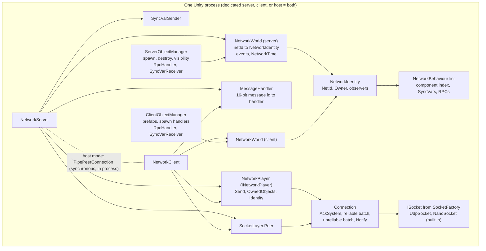

> Verified against main @ 0638bf8e5

# Mirage research for SimpleCSP

Reference notes on how Mirage's object model, SyncVars, RPCs, messages, update loop and serializer actually behave, written for the author of **SimpleCSP**, a per-network-object client-side prediction system (server-authoritative FPS, 16-32 players, each predicted object owns its input/state buffers and reconciles on its own). Every claim is tied to a `path:line` in this repository; file 07 is an explicit *assessment* of what SimpleCSP can reuse and what it must build.

Baseline: `origin/main` @ `0638bf8e5`, package 159.1.1 (`Assets/Mirage/package.json:4`). Tags used in the files: *(inferred)* = reasoned from code, *(unverified)* = needs an in-engine check.

> **Branch note.** The brief said the SyncVar-as-properties work is on `main`. In this repo it is not: on `main` `[SyncVar]` is **field-only** (`Assets/Mirage/Runtime/CustomAttributes.cs:10`) and `PropertySiteProcessor` rewrites field accesses; the property version lives only on `origin/master` @ `7116e9f`. Files 01-06 were first written against `master` and have been corrected for `main` (see the "master differs" notes inside them). Details in file 07 section 0.

## Index

| File | What it covers |
|---|---|
| [01-Objects-Ownership-Lifecycle.md](01-Objects-Ownership-Lifecycle.md) | `NetworkIdentity`/`NetworkBehaviour`, component index, server/client/world accessors, `Owner` vs `HasAuthority` vs `IsLocalPlayer`, lifecycle events and their order, spawn/destroy, interest management (hide = destroy on client), host-mode spawn order |
| [02-SyncVars-and-State-Sync.md](02-SyncVars-and-State-Sync.md) | `[SyncVar]` fields and the generated setter, dirty bits and `SyncVarSender`, `SyncSettings` (direction, interval, timing), reliable-only delivery, owner vs observer payloads, hooks and their timing, initial state, SyncObjects, "state + tick" patterns |
| [03-RPCs-and-Messages.md](03-RPCs-and-Messages.md) | `[ServerRpc]`/`[ClientRpc]` options, what the weaver generates, send and receive paths, return-value RPCs, wire format, Reliable/Unreliable/Notify channels, batching, custom `[NetworkMessage]`, rate limits and error budget, host-mode semantics |
| [04-Update-Loop-and-Timing.md](04-Update-Loop-and-Timing.md) | The two Unity entry points, `UpdateReceive` then `UpdateSent`, where handlers/hooks/flushes run, `ManualUpdate`, FixedUpdate implications, timing constants, pointer to `NetworkTime` |
| [05-Serialization.md](05-Serialization.md) | Bit-level `NetworkWriter`/`NetworkReader`, default encodings, weaver-generated serializers and their triggers, custom readers/writers, bit-packing attributes, `[MaxLength]`, pooling, recipe for a compact input/state struct |
| [06-Existing-Components.md](06-Existing-Components.md) | What ships in `Components/` and samples; `NetworkTransform` and its interpolation; confirmation that no prediction/rewind/snapshot code exists; closest design precedents |
| [07-Gaps-and-Hooks-for-CSP.md](07-Gaps-and-Hooks-for-CSP.md) | **Assessment.** What Mirage gives CSP, what is missing, extension points, answers to the specific questions (generic behaviours with RPCs, allocation-free payloads, unreliable/targeted sends, timing vs Update/FixedUpdate, batching), gotchas (hooks, head-of-line blocking, dirty flags, host mode, unreliable vs SyncVar ordering), bandwidth cheat sheet |
| [../ClientSidePrediction/TickRunner-and-TimeSync-Mirage.md](../ClientSidePrediction/TickRunner-and-TimeSync-Mirage.md) | Sibling report: `NetworkTime` accuracy and quirks, RTT/ack information in the SocketLayer, whether Mirage time can align CSP ticks (not repeated here) |

## Mirage architecture on one page



- **`NetworkServer` / `NetworkClient`** (`Assets/Mirage/Runtime/NetworkServer.cs`, `NetworkClient.cs`): MonoBehaviours that own a `Peer`, a `MessageHandler`, a `NetworkWorld` and a `SyncVarSender`; their `Update()` is Mirage's only per-frame hook (`NetworkServer.cs:421-445`, `NetworkClient.cs:377-406`).
- **`NetworkWorld`** (`Assets/Mirage/Runtime/NetworkWorld.cs`): per-side registry `netId -> NetworkIdentity`, spawn/unspawn/authority events, and the `NetworkTime` instance (`:34-54`).
- **`NetworkIdentity` / `NetworkBehaviour`**: one identity per hierarchy root, up to 255 behaviours addressed by component index; SyncVars, RPCs, `OnSerialize` live on the behaviours (`NetworkIdentity.cs:301-319`, `NetworkBehaviour.cs:23`).
- **`NetworkPlayer`** (`INetworkPlayer`): the server's handle on one connection (and the client's handle on its server link); owns the `IConnection`, the owned-object list, the character and the error budget (`Assets/Mirage/Runtime/NetworkPlayer.cs`).
- **`ServerObjectManager` / `ClientObjectManager`**: spawning, destroying, visibility (`observers`), authority messages, prefab/spawn-handler registry, and the RPC and SyncVar receive handlers (`ServerObjectManager.cs:421-498`, `ClientObjectManager.cs:116-140, 568-661`).
- **`SocketLayer.Peer`** (`Assets/Mirage/Runtime/SocketLayer/Peer.cs`): Mirage's built-in "transport": connection state, reliability (sequence/ack/resend), batching, fragmentation, Notify, keep-alive, timeouts, over an `ISocket`.
- **Sockets / "transports"** are `ISocket` plus a `SocketFactory` component (`Assets/Mirage/Runtime/SocketLayer/SocketFactory.cs:33-58`). Only UDP ships in this repo (`Assets/Mirage/Runtime/Sockets/Udp/`, managed `UdpSocket` or native NanoSockets); Steam and WebSocket sockets are separate packages (`doc/docs/general/sockets.md:13-28`). A WebSocket-style socket uses `PeerConfigProfile.WebSocket`, which maps Unreliable/Notify onto Reliable (`Assets/Mirage/Runtime/SocketLayer/Config.cs:121-154`).

Message path for a `[ServerRpc]` (Unreliable):

```
client code calls Foo()                      -> weaver stub: pooled writer, args serialized
  ServerRpcSender.Send                       (ServerRpcSender.cs:16-31)
  NetworkClient.Send -> NetworkPlayer.Send   (NetworkClient.cs:344-355, NetworkPlayer.cs:267-293)
  IConnection.SendUnreliable                 -> appended to the unreliable batch (queued)
  ...end of the same Unity Update:
  NetworkClient.UpdateSent -> Peer.UpdateSent -> FlushBatch -> ISocket.Send      (NetworkClient.cs:400-406)
server, next Update:
  NetworkServer.UpdateReceive -> Peer.UpdateReceive -> ISocket.Poll/Receive      (Peer.cs:281-349)
  Connection -> DataHandler -> MessageHandler -> RpcHandler.HandleRpc            (RpcHandler.cs:79-214)
  owner check, rate limit, skeleton -> UserCode_Foo (your method body)
```

Unity frame order around Mirage (file 04): `FixedUpdate` x k (Mirage does nothing) -> `Update` (your scripts and `NetworkServer/Client.Update`, relative order undefined unless you set it: `UpdateReceive` runs every handler, then `UpdateSent` flushes SyncVars and sockets) -> `LateUpdate`.

## Facts that matter for per-object CSP

1. **Two channels plus Notify.** `Channel` is `Reliable` or `Unreliable` only (`Assets/Mirage/Runtime/Channel.cs:3-7`). Notify (acked, unbatched, drops late/duplicate packets) is reachable only through `Send(msg, INotifyCallBack)` (`NetworkPlayer.cs:301-330`). RPCs default to **Reliable** (`CustomAttributes.cs:84, 142`).
2. **SyncVars, SyncLists, `OnSerialize` and spawn data are reliable-only** and share one ordered stream with reliable RPCs, spawns and destroys (`SyncVarSender.cs:111, 138`). There is no per-behaviour channel option (`SyncSettings.cs:10-29`).
3. **Head-of-line blocking is real.** A lost reliable packet stalls every later reliable message until it is resent; loss is detected only from acks and resent once per frame, with no retransmit timer (`AckSystem.cs:186-200, 231-247, 644-733`). Inputs and per-tick state should not ride the reliable channel.
4. **Frame-bound loop, no tick.** `NetworkServer.Update`/`NetworkClient.Update` run `UpdateReceive` then `UpdateSent`; nothing runs in `FixedUpdate`, there is no execution-order attribute, and the sim tick is yours (`NetworkServer.cs:421-445`). A ServerRpc body runs in the `Update` phase, so it can only enqueue inputs for the next `FixedUpdate`.
5. **Sends leave once per Mirage `Update`.** Anything queued before `UpdateSent` (including from `FixedUpdate`) goes out that frame; Notify goes out immediately; a full batch flushes early (`Batch.cs:23-40`). `ManualUpdate = true` lets you place `UpdateReceive()`/`UpdateSent()` yourself (`NetworkServer.cs:205`, `NetworkClient.cs:123`).
6. **Batching: yes.** Reliable and unreliable messages queued in one frame share packets (2-byte length prefix each; packets are at most 1232 bytes on default UDP, with a largest single message of 1215 reliable-unfragmented / 1229 unreliable bytes); k fixed ticks per frame go out together, but each message keeps its own header (`ReliableConnection.cs:80-103, 302-306`).
7. **SyncVar behaviour.** Per-component dirty bit; flushed once per frame by `SyncVarSender.Update`; default `SyncSettings` = `From.Server`, `To.Owner | ObserversOnly`, `Interval = 0.1 s`, `Variable` timing; only the latest value at flush time is sent; bits are cleared when serialized, not when delivered; `OnSerialize`'s return value is ignored (`NetworkIdentity.cs:794-804, 844`, `SyncSettings.cs:24-29`). Hooks run per variable in declaration order during `UpdateReceive` and during spawn before `OnStartClient`; on the host the setter runs them (`SyncVarProcessor.cs:236-267, 584-617`).
8. **`[SyncVar]` is a field on `main`**, rewritten to a generated `Network<Name>` property in the same assembly only; writes from another assembly or by `ref` do not mark dirty (`PropertySiteProcessor.cs:18-39, 127-163`).
9. **RPC options.** `[ServerRpc(channel, requireAuthority = true, allowServerToCall)]`; `[ClientRpc(channel, target = Observers|Owner|Player, excludeOwner, excludeHost)]`; `[RateLimit]` (server and, on main, client-side too); return-value RPCs are always Reliable (`CustomAttributes.cs:82-147`, `ServerRpcSender.cs:53-54, 81-89`).
10. **Owner-only / observers-except-owner.** ClientRpc `target = Owner`, or `Observers` + `excludeOwner = true`; SyncVars via `SyncTo.Owner` / `SyncTo.ObserversOnly`; custom messages via `identity.Owner.Send` and `Server.SendToObservers(..., excludeOwner: true, ...)` (`NetworkServer.cs:644-656`). `Owner`/`Player` targets ignore visibility (`ClientRpcSender.cs:34-45`).
11. **Unreliable has no sequence numbers** (loss, duplication, reordering possible), is limited to one MTU (1229 bytes of message on default UDP, `MessageSizeException` otherwise), and has no ordering relative to the reliable/SyncVar stream (`ReliableConnection.cs:89-108`, `Peer.cs:873-879`). Put a tick in every payload.
12. **Host mode is inline.** `IsServer` and `IsClient` are both true; the host's pipe delivers synchronously and re-entrantly; a ClientRpc body runs locally *before* the message is built, a ServerRpc runs inline with no message, the host never receives `UpdateVarsMessage`, and there is no ping (`NetworkIdentity.cs:129-144`, `PipePeerConnection.cs:78-128`, `ClientRpcSender.cs:114-168`, `ServerRpcSender.cs:99-118`).
13. **Generic behaviours with RPCs work** (declaring class generic, parameters `T` or concrete, deep chains; runtime-tested) but the RPC method cannot be generic, abstract RPC methods are an error, `T[]`/`List<T>` of the open `T` is untested, and each concrete `T` needs a registered serializer (tag it `[NetworkMessage]`) (`Assets/Tests/Runtime/ClientServer/Generics/WithGenericRpc.cs`, `RpcProcessor.cs:256-274`; file 07 Q1).
14. **Allocation.** `ArraySegment<byte>` parameters are allocation-free (a view into the receive buffer, valid inside the RPC body); `T[]`, `List<T>`, `ArraySegment<T>` and class parameters allocate per receive; struct messages send allocation-free (`CollectionExtensions.cs:68-71, 305-340`, `NetworkReader.cs:421-431`, `Assets/Tests/Runtime/SendToAllocations.cs`).
15. **Objects are re-created.** Leaving visibility destroys (or pools/deactivates) the client object; `AssignClientAuthority`/`ReplaceCharacter` re-send the spawn message, re-running initial-state hooks and re-applying spawn position/rotation; an RPC for an object the client does not have is dropped (`ClientObjectManager.cs:495-530, 568-595`, `NetworkIdentity.cs:1156-1181`, `RpcHandler.cs:90-120`).
16. **Server protection that can bite a 60 Hz input stream.** Error budget 200 tokens refilling 50/s (disconnect when exceeded): ownership failure costs 10, unknown object 1, deserialization failure 50, `[MaxLength]` violation 100; a 5 s grace window (1 s on `master`) after ownership removal or destroy (`NetworkServer.cs:137-145`, `RpcHandler.cs:18, 90-174`).
17. **Cost model.** `RpcMessage` overhead is about 7 bytes (batch length 2, id 2, NetId 1, index 1, payload length 1) plus payload; packet headers are 1 (unreliable), 15 (reliable), 13 (Notify); a `ClientRpc` to N observers is packed once and copied N times (`NetworkServer.cs:671-695`; file 07 section 6).
18. **Time is coarse.** `NetworkTime` pings every 2 s with EMA smoothing, has no notion of ticks and is frame-quantised; treat it as a seed (see the sibling report).

## How to read these files

Start with 07 for decisions, then follow its pointers: 02 and 03 for exact SyncVar/RPC behaviour, 04 for ordering and timing, 05 for payload sizing, 01 for lifecycle/ownership/host-mode edge cases, 06 for what already exists in the repo.
